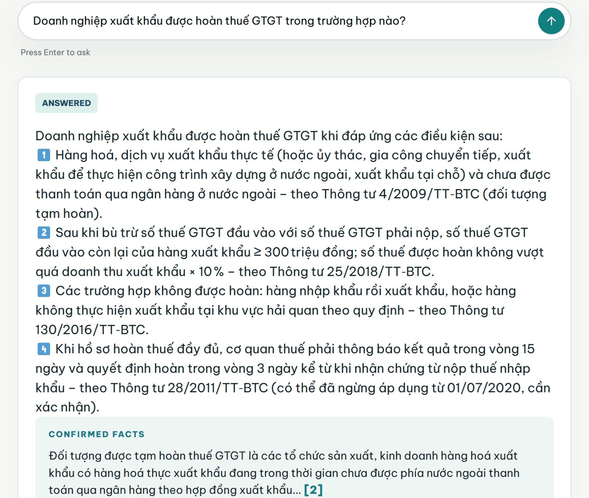
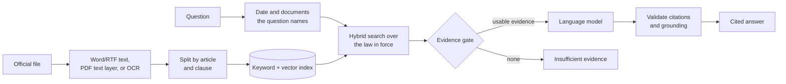
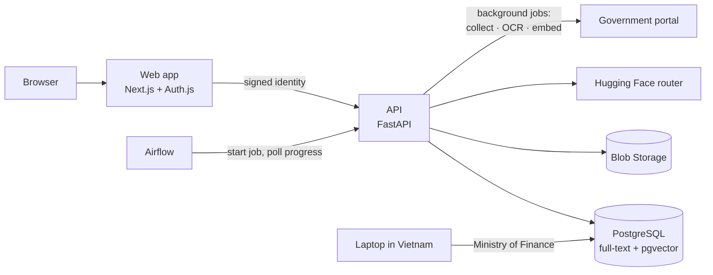
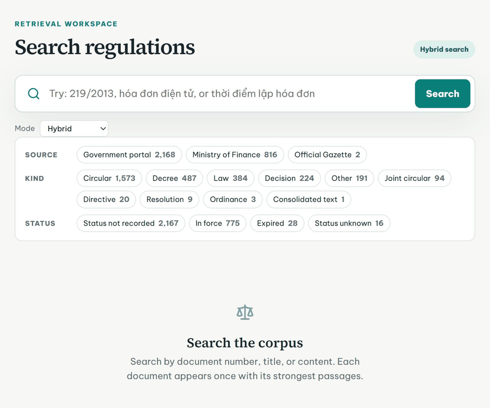
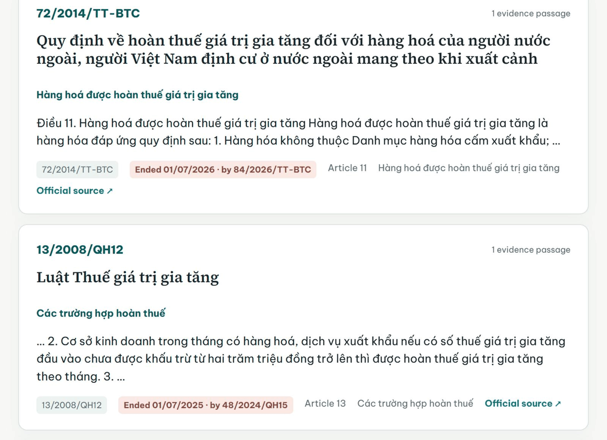

<p align="center"></p>

# TaxLens AI

**Search Vietnamese tax law and get answers cited to the exact article.**

TaxLens collects official tax documents from Vietnamese government sources back to 1990,
splits them into article- and clause-level passages, and answers questions only from
those passages. Every answer cites the document, article, clause, and page it relies on,
quotes the source text, applies the law in force for the date the question is about, and
says so when the indexed documents do not answer the question.

**Live development deployment:**
[taxlens-dev-web.wonderfulfield-8256aab7.eastasia.azurecontainerapps.io](https://taxlens-dev-web.wonderfulfield-8256aab7.eastasia.azurecontainerapps.io)
(sign-in required; after 10 idle minutes the API scales to zero, and the next question waits about a minute)



## Features

- **Cited answers** in the language of the question, explained in plain language with
  practical next steps. Confirmed facts are checked against the passages they cite, and
  citations carry verbatim source excerpts and a link to the official source.
- **The law of the right date.** A question about "tháng 6/2023" is answered with the rules
  in force then. Documents a later document repeals, or that the Ministry of Finance records as
  expired, are left out; those that may have ended are flagged ("Ended 01/07/2022 · by
  78/2021/TT-BTC").
- **Explicit refusals**: out-of-scope questions, missing evidence, superseded-only
  evidence, and model failures each return their own status instead of a guess.
- **Search** by document number, title, or content, filtered by source, kind, and legal
  status: matching documents first, then passages ranked by hybrid search, ten per page.
  Content search tolerates missing diacritics (`hoa don` finds `hóa đơn`) and OCR errors.
- **Feedback**: every answer can be rated 👍/👎 with a comment; questions and ratings are
  logged as candidates for the evaluation's gold set.
- **Document library** (administrators): corpus statistics, search by number or title,
  filters, and paged browsing of documents and their passages, plus a spreadsheet export.
- **Vietnamese and English** throughout, in one typeface with full Vietnamese support;
  keyboard and screen-reader accessible.
- **Historical corpus**: 2,986 documents (144,279 passages) from the government portal and
  the Ministry of Finance database, including pre-Unicode Word files from the 1990s.
- **Measured, not assumed**: a clause-labelled gold set, frozen corpus versions, an answer
  grader, and a record of every experiment, so each change is compared against evidence.

## How answers are made



1. **Collection**: tax documents from the government portal's tax category and the
   Ministry of Finance database (with legal status and effective dates), preferring Word
   files, whose text needs no OCR. See [docs/pipeline.md](docs/pipeline.md).
2. **Processing**: text is read natively (including legacy TCVN3 and Windows Vietnamese
   encodings) or with Vietnamese Tesseract OCR, then split along the legal structure
   (*Điều* → *khoản*, or *Phần* / numbered sections in older documents) into passages of
   at most 1,500 characters with article, clause, and page.
3. **Planning**: the period the question names (or today), and any document numbers in it.
   Documents that ended before that period, and versions not yet in force, are left out.
4. **Retrieval**: diacritic-insensitive keyword ranking over every term of the question and
   `multilingual-e5-small` vector search, combined by reciprocal rank fusion; the five best
   passages with an article or page become the evidence.
5. **Evidence gate**: clearly unrelated questions are refused before any model call; documents
   that may have ended are used last, and noted.
6. **Answer**: the model answers from numbered passages or says they do not answer the
   question; facts not supported by their cited passage are removed.

Method and thresholds: [docs/retrieval.md](docs/retrieval.md).

## Results so far

On 30 scored gold cases (from tax-authority letters and reviewed law-text cases, `corpus-v2.1`),
with documents labelled to the clause:

| Measure | Result |
| --- | --- |
| Essential provisions found in the top 5 / 10 / 20 passages | 0.31 / 0.47 / 0.53 |
| Answers to 15 gold questions, judged against the gold answers | 8 correct, 2 wrong, 5 refused |
| Time for a warm answer | about 5.5 s (retrieval 4 s, model 1.5 s) |

Answers were graded on the first 15 questions. 30 cases still separate only large differences,
and neither grader is a tax expert. Details, known problems, and what is next: [docs/evaluation-status.md](docs/evaluation-status.md).

## Architecture



- The **web app** is the only public service. It holds the session and signs every
  request it forwards to the internal-only **API**.
- The **API** serves search, answers, feedback, and the library, logs each answer's timings,
  and runs long jobs (collection, OCR, embedding) as background subprocesses that **Airflow**
  starts and polls.
- **PostgreSQL** stores documents, passages, full-text vectors, embeddings, document endings,
  and the question log; **Blob Storage** keeps the source files and extracted text.
- The **Ministry of Finance** database accepts Vietnamese IPs only, so it is collected
  from a laptop in Vietnam straight into the Azure database.

Components, data model, request flow, logging, and design decisions:
[docs/architecture.md](docs/architecture.md).

## Tech stack

| Area | Technology |
| --- | --- |
| Web | Next.js 15, TypeScript, Auth.js; Be Vietnam Pro and Source Serif 4 |
| API | FastAPI, Python 3.12, SQLAlchemy 2, Alembic |
| Search | PostgreSQL full-text search, pgvector |
| Embeddings | `intfloat/multilingual-e5-small` on CPU, baked into the API image |
| Answers | Hugging Face Inference Providers (OpenAI-compatible), LangGraph |
| Documents | Tesseract (`vie`), pypdf and pypdfium2, olefile (Word 97), RTF and DOCX parsers |
| Pipelines | Apache Airflow 2.10, MLflow (optional) |
| Quality | pytest, ruff, mypy; Vitest, ESLint; a gold set with frozen corpus manifests |
| Cloud | Azure Container Apps, PostgreSQL Flexible Server, Blob Storage, Key Vault, Container Registry, Log Analytics |
| Delivery | Terraform, GitHub Actions with Azure OIDC |

## Run locally

Requires Python 3.12 and Docker Desktop.

```powershell
Copy-Item .env.example .env          # set AUTH_INITIAL_ADMIN_PASSWORD, and HF_TOKEN for answers
docker compose up -d postgres api web
docker compose exec -T api alembic upgrade head
docker compose exec -T api python scripts/seed.py
```

Open <http://localhost:3000>; the API's OpenAPI page is at <http://localhost:8000/docs>.
To build a real corpus, collect, process, and embed a batch:

```powershell
docker compose exec -T api python scripts/collect_sources.py --since-days 60 --limit 20
docker compose exec -T api python scripts/process_corpus.py
docker compose exec -T api python scripts/embed_corpus.py
```

The checks CI runs:

```powershell
python -m ruff check src tests scripts
python -m mypy src
python -m pytest
cd apps/web; npm install; npm run lint; npm test; npm run build
```

More in [docs/operations.md](docs/operations.md#local-development).

## Deploy and operate

1. Merge a pull request into `main` (protected; see
   [release](docs/operations.md#release)); **CI** runs backend checks, the web lint, tests,
   and build, and Terraform validation.
2. Run **Release and deploy** on `main` (`gh workflow run release.yml --ref main`). It builds
   the API, web, and Airflow images tagged with the commit SHA, then plans and applies the
   Terraform update with them. The API applies database migrations when it starts.

Do not deploy while an Airflow run is in progress; a deploy restarts the API and its jobs.
Backfills, the Ministry of Finance laptop run, logs, and troubleshooting are in
[docs/operations.md](docs/operations.md).

Answers need a Hugging Face token with inference credits. Without them, every question
returns `PROVIDER_UNAVAILABLE`; search and the library still work.

## Documentation

| Document | Contents |
| --- | --- |
| [evaluation-status.md](docs/evaluation-status.md) | **Start here:** what is live, results, known problems, to do |
| [architecture.md](docs/architecture.md) | Components, request flow, data model, authentication, logging, Azure, design decisions |
| [retrieval.md](docs/retrieval.md) | Extraction, chunking, search, ended documents, evidence gate, answers, evaluation |
| [pipeline.md](docs/pipeline.md) | Sources, what is collected, Airflow DAGs |
| [operations.md](docs/operations.md) | Local development, laptop access, growing the corpus, release, costs, logs, troubleshooting |
| [retrieval-experiments.md](docs/retrieval-experiments.md) | **Already tried:** read before any run, so nothing is paid for twice |
| [changelog.md](docs/changelog.md) | What each working stint changed, newest first |
| [corpus-inclusion.md](docs/corpus-inclusion.md) | Rules for what enters the corpus |
| [annotation-guideline.md](docs/annotation-guideline.md) | How to label cases for the evaluation gold set |

## Limitations

TaxLens is a development-stage research tool, **not legal or tax advice**.

- Answers are only as complete as the corpus. Official letters (*công văn*) and
  provincial documents are not collected.
- Search finds what a question words. A rule it depends on but does not mention, such as late
  interest after a returned export, is often missed.
- Answer accuracy is measured on few cases (8 of 15 correct, 2 wrong), so it is a direction, not a
  guarantee.
- Most government PDFs are scans, so OCR errors affect search and quotations.
- Ended documents are recognised only when a later document in the corpus repeals them or
  the Ministry of Finance records their expiry. Documents that may have ended by inference are
  flagged, not left out; answers use them only when too few other passages are found. See
  [ended documents](docs/retrieval.md#ended-documents).
- The corpus is frozen, so new documents are not collected until it is deliberately updated.
- Development-scale Azure resources scale to zero, so the first request after idle is
  slow.

## Screenshots

| Search workspace | Search results |
| --- | --- |
|  |  |
