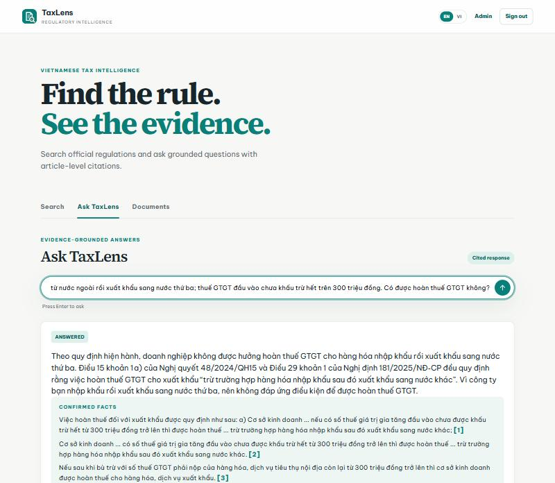
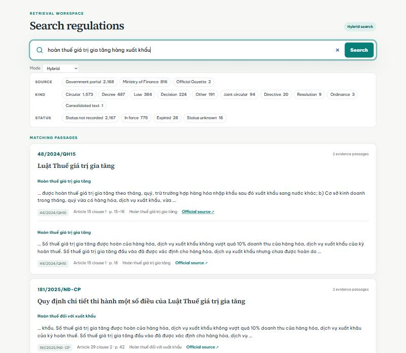
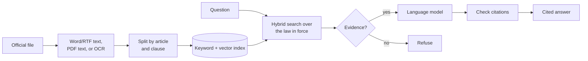

<p align="center"></p>

# TaxLens AI

**Search Vietnamese tax law and get answers cited to the exact article.**

TaxLens is both an engineering project and a research project:

- **The system** collects official tax documents back to 1990 (2,986 documents, 144,279
  passages), splits them by article and clause, and answers only from those passages, citing
  each one and applying the law in force on the date asked about.
- **The research** builds a benchmark of real practitioner questions and uses it to find out
  what stops a search system from finding the provisions that decide an answer.

**Live development site:**
[taxlens-dev-web…azurecontainerapps.io](https://taxlens-dev-web.wonderfulfield-8256aab7.eastasia.azurecontainerapps.io)
(sign-in required; the first question after 10 idle minutes takes about a minute)

| Ask | Search |
| --- | --- |
|  |  |

## The system

- **Cited answers** in the question's language, with verbatim excerpts and official links;
  facts not supported by their cited passage are removed.
- **The law of the right date**: ended documents are left out and tagged; those that may
  have ended are flagged and used last.
- **Refusals instead of guesses** when a question is out of scope or the evidence is missing.
- **Search** by number, title or content, filtered by source, kind and status; tolerates missing
  diacritics and OCR errors.
- **Fast**: a warm answer takes about 5.5 seconds.



Keyword ranking and `multilingual-e5-small` vectors in PostgreSQL are fused by reciprocal rank
fusion; the five best passages become the evidence. Details: [retrieval.md](docs/retrieval.md),
[architecture.md](docs/architecture.md).

**Stack:** Next.js 15 and Auth.js · FastAPI and PostgreSQL (full-text + pgvector) · Hugging Face
Inference Providers · Tesseract OCR · Airflow · Azure Container Apps, Terraform, GitHub Actions.

## The research

Tax questions rarely name the provisions that decide them. A question about a returned export,
for example, depends on rules about refunds, declarations and late interest that it never
mentions. The research asks how far retrieval can close that gap.

So far:

- **A benchmark**: 34 practitioner questions from tax-authority letters and the law text, each
  with a reference answer and its essential provisions labelled to the clause, over frozen
  corpus versions, with answers graded against the references.
- **The cause of misses**: when the missing legal issue is named by hand, search recovers about
  two thirds of the provisions it missed (top 20), so both retrieval and recognising the issue
  matter.
- **Discipline**: every method is tested against the baseline with its plan and decision rule
  written first, and every result is kept, including rejected ones
  ([retrieval-experiments.md](docs/retrieval-experiments.md)).
- **Expert validation**: a tax expert is reviewing the gold provisions, the answer grades and
  which old documents have ended.

Status, results and next steps: [evaluation-status.md](docs/evaluation-status.md).

## Run locally

Requires Python 3.12 and Docker Desktop.

```powershell
Copy-Item .env.example .env          # set AUTH_INITIAL_ADMIN_PASSWORD, and HF_TOKEN for answers
docker compose up -d postgres api web
docker compose exec -T api alembic upgrade head
docker compose exec -T api python scripts/seed.py
```

Open <http://localhost:3000>. Building a corpus, checks, release and deploy:
[operations.md](docs/operations.md).

## Documentation

| Document | Contents |
| --- | --- |
| [evaluation-status.md](docs/evaluation-status.md) | **Start here:** what is live, results, known problems, to do |
| [retrieval-experiments.md](docs/retrieval-experiments.md) | Everything already tried; read before any run |
| [architecture.md](docs/architecture.md) | Components, data model, authentication, Azure |
| [retrieval.md](docs/retrieval.md) | Extraction, search, ended documents, answers |
| [pipeline.md](docs/pipeline.md) | Sources and Airflow DAGs |
| [operations.md](docs/operations.md) | Local development, corpus, release, troubleshooting |
| [changelog.md](docs/changelog.md) | Changes by working stint |
| [corpus-inclusion.md](docs/corpus-inclusion.md), [annotation-guideline.md](docs/annotation-guideline.md) | What enters the corpus; how gold cases are labelled |

## Limitations

A research tool, **not legal or tax advice**. Official letters (*công văn*) and provincial
documents are not collected, and many sources are OCR'd scans.
