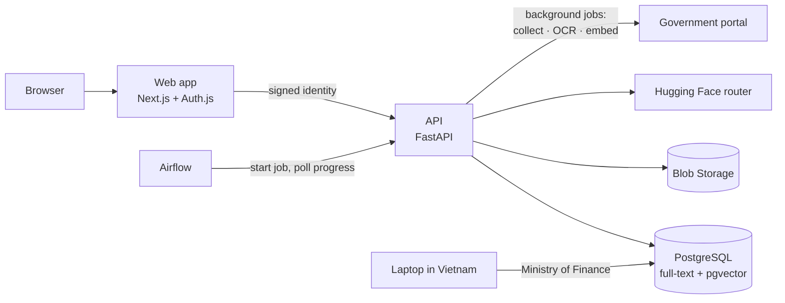
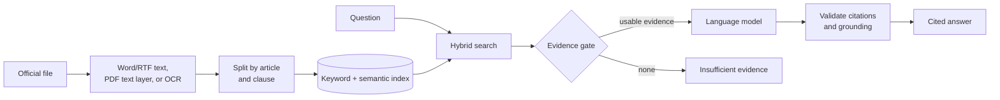

<p align="center"></p>

# TaxLens AI

**Search Vietnamese tax law and get answers cited to the exact article.**

TaxLens collects official tax documents from Vietnamese government sources back to 1990,
splits them into article- and clause-level passages, and answers questions only from
those passages. Every answer cites the document, article, clause, and page it relies on,
quotes the source text, and says so when the indexed documents do not answer the
question.

**Live development deployment:**
[taxlens-dev-web.wonderfulfield-8256aab7.eastasia.azurecontainerapps.io](https://taxlens-dev-web.wonderfulfield-8256aab7.eastasia.azurecontainerapps.io)
(sign-in required; the first page after idle takes up to a minute)


## Features

- **Hybrid search** over Vietnamese legal text that tolerates missing diacritics
  (`hoa don` finds `hóa đơn`) and OCR errors.
- **Cited answers** in the language of the question. Confirmed facts are checked against
  the passages they cite, and citations carry verbatim source excerpts.
- **Explicit refusals**: out-of-scope questions, missing evidence, superseded-only
  evidence, and model failures each return their own status instead of a guess.
- **Document library**: corpus statistics at a glance, search by number or title,
  filters by source, kind (law, decree, circular, …), and legal status, and paged
  browsing of documents and their passages. English and Vietnamese throughout.
- **Historical corpus**: about 2,000 tax documents (59,598 passages) from the government
  portal and the Ministry of Finance database, including pre-Unicode Word files from the
  1990s.
- **Automated pipeline**: Airflow collects new documents daily, extracts or OCRs them,
  indexes them, and evaluates retrieval; maintenance actions handle backfills and
  repairs, with live progress in the task log.
- **Accounts** with administrator and user roles.

## Architecture



- The **web app** is the only public service. It holds the session and signs every
  request it forwards to the internal-only **API**.
- The **API** serves search, answers, and the library, and runs long jobs (collection,
  OCR, embedding) as background subprocesses that **Airflow** starts and polls.
- **PostgreSQL** stores documents, passages, full-text vectors, and embeddings; **Blob
  Storage** keeps the source files and extracted text.
- The **Ministry of Finance** database accepts Vietnamese IPs only, so it is collected
  from a laptop in Vietnam straight into the Azure database.

Full component, data-model, and job-runner description: [docs/architecture.md](docs/architecture.md).

## How answers are made



1. **Collection**: tax documents from the government portal's tax category and the
   Ministry of Finance database (with legal status and effective dates), preferring Word
   files, whose text needs no OCR. See [docs/pipeline.md](docs/pipeline.md).
2. **Processing**: text is read natively (including legacy TCVN3 and Windows Vietnamese
   encodings) or with Vietnamese Tesseract OCR, then split along the legal structure
   (*Điều* → *khoản*, or *Phần* / numbered sections in older documents) into passages of
   at most 1,500 characters with article, clause, and page.
3. **Retrieval**: diacritic-insensitive keyword ranking and `multilingual-e5-small`
   semantic search, combined by reciprocal rank fusion.
4. **Evidence gate**: superseded and unlocated passages are set aside, and clearly
   unrelated questions are refused before any model call.
5. **Answer**: the model answers from numbered passages or says they do not answer the
   question; facts not supported by their cited passage are removed.

Method, thresholds, and measured results: [docs/retrieval.md](docs/retrieval.md).

## Tech stack

| Area | Technology |
| --- | --- |
| Web | Next.js 15, TypeScript, Auth.js |
| API | FastAPI, Python 3.12, SQLAlchemy 2, Alembic |
| Search | PostgreSQL full-text search, pgvector |
| Embeddings | `intfloat/multilingual-e5-small` on CPU, baked into the API image |
| Answers | Hugging Face Inference Providers (OpenAI-compatible), LangGraph |
| Documents | Tesseract (`vie` + `eng`), pypdf and pypdfium2, olefile (Word 97), RTF and DOCX parsers |
| Pipelines | Apache Airflow 2.10, MLflow (optional) |
| Cloud | Azure Container Apps, PostgreSQL Flexible Server, Blob Storage, Key Vault, Container Registry, Log Analytics |
| Delivery | Terraform, GitHub Actions with Azure OIDC |

## Run locally

Requires Python 3.12 and Docker Desktop.

```powershell
Copy-Item .env.example .env          # set AUTH_INITIAL_ADMIN_PASSWORD, and HF_TOKEN for answers
docker compose up -d postgres api web
docker compose exec -T api alembic upgrade head
docker compose exec -T api python scripts/seed.py
```

Open <http://localhost:3000>; the API's OpenAPI page is at <http://localhost:8000/docs>.
To build a real corpus, collect, process, and embed a batch:

```powershell
docker compose exec -T api python scripts/collect_sources.py --since-days 60 --limit 20
docker compose exec -T api python scripts/process_corpus.py
docker compose exec -T api python scripts/embed_corpus.py
```

The checks CI runs:

```powershell
python -m ruff check src tests scripts
python -m mypy src
python -m pytest
```

More in [docs/operations.md](docs/operations.md#local-development).

## Deploy and operate

1. Merge a pull request into `main` (protected; see
   [contributing](docs/operations.md#contributing)); **CI** runs backend checks, the web
   build, and Terraform validation.
2. Run **Release and deploy** on `main`. It builds the API, web, and Airflow images tagged
   with the commit SHA, then plans and applies the Terraform update with them. The API
   applies database migrations when it starts.

Do not deploy while an Airflow run is in progress; a deploy restarts the API and its jobs.
Backfills, the Ministry of Finance laptop run, logs, and troubleshooting are in
[docs/operations.md](docs/operations.md).

Answers need a Hugging Face token with inference credits. Without them, every question
returns `PROVIDER_UNAVAILABLE`; search and the library still work.

## Documentation

| Document | Contents |
| --- | --- |
| [architecture.md](docs/architecture.md) | Components, data model, request path, document library, background jobs, authentication, Azure resources, design decisions |
| [pipeline.md](docs/pipeline.md) | Official sources, what is collected, the daily and maintenance Airflow DAGs |
| [retrieval.md](docs/retrieval.md) | Extraction, chunking, search, evidence gate, answer validation, evaluation |
| [operations.md](docs/operations.md) | Local development, contributing, release, backfills, laptop collection, logs, troubleshooting |
| [annotation-guideline.md](docs/annotation-guideline.md) | How to label cases for the evaluation gold set |

## Limitations

TaxLens is a development-stage research tool, **not legal or tax advice**.

- Answers are only as complete as the corpus. Official letters (*công văn*) and
  provincial documents are not collected.
- Most government PDFs are scans, so OCR errors affect search and quotations.
- Government-portal documents have no recorded legal status (`DISCOVERED`) unless the
  Ministry of Finance record exists; answers flag this.
- About a third of passages exceed the embedding model's 512-token input, so their
  semantic vector covers only the start; keyword search sees the full text.
- New Ministry of Finance documents need a manual laptop run; the government portal is
  collected daily.
- Development-scale Azure resources scale to zero, so the first request after idle is
  slow.

## Screenshots

| Search | Results |
| --- | --- |
|  |  |
