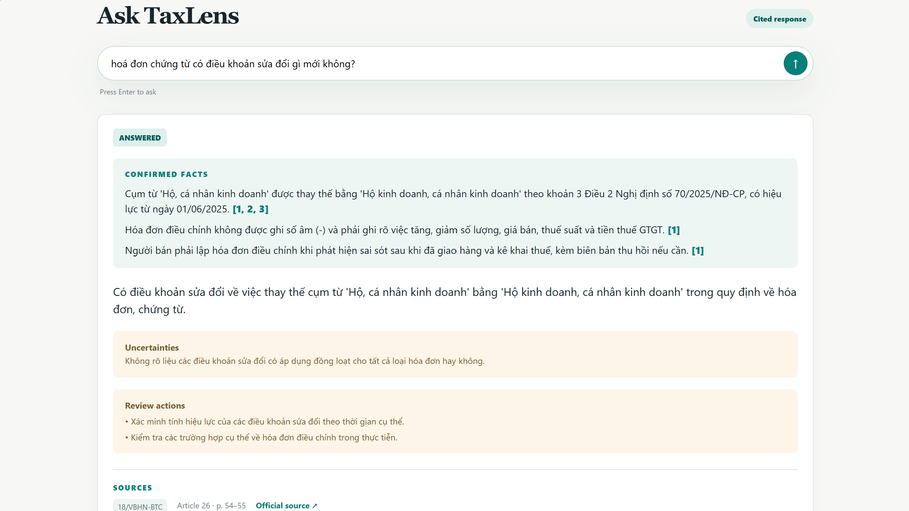
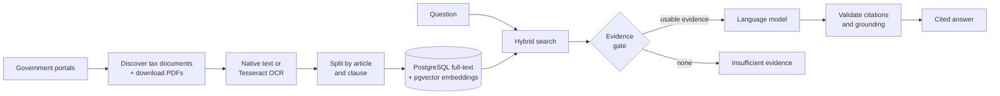
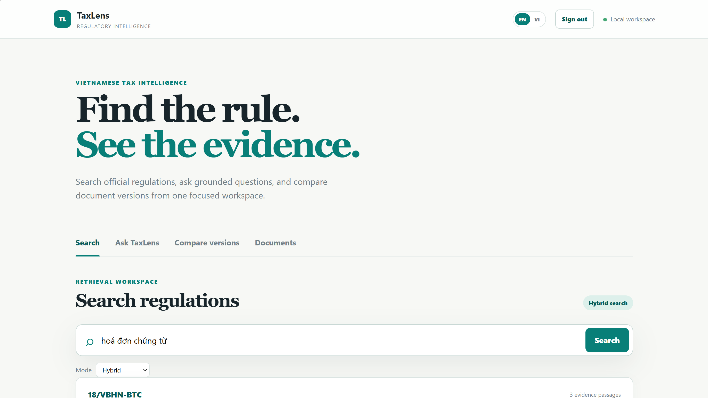
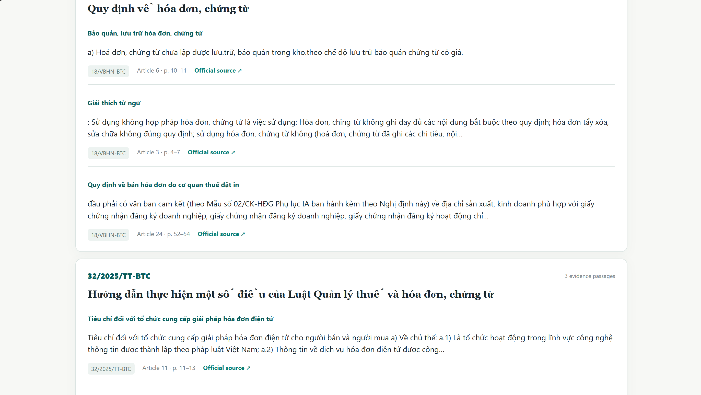

# TaxLens AI

**Search Vietnamese tax regulations and get answers cited to the exact article.**

TaxLens collects official tax documents from Vietnamese government portals, splits
them into article- and clause-level passages, and answers questions only from
those passages. Every answer cites the document, article, clause, and page it
relies on, quotes the source text, and says so when the indexed documents do not
answer the question.

**Live development deployment:**
[taxlens-dev-web.wonderfulfield-8256aab7.eastasia.azurecontainerapps.io](https://taxlens-dev-web.wonderfulfield-8256aab7.eastasia.azurecontainerapps.io)
(sign-in required)



## Features

- **Hybrid search**: keyword and semantic search over Vietnamese legal text that
  tolerates missing diacritics (`hoa don` finds `hóa đơn`) and OCR errors.
- **Cited answers**: answers in the language of the question, with confirmed facts
  that are checked against the passages they cite and verbatim source excerpts.
- **Explicit refusals**: out-of-scope questions, missing evidence, superseded-only
  evidence, and model failures each return a distinct status instead of a guess.
- **Document library**: every indexed document with its versions, processing
  status, and passages.
- **Daily ingestion**: an Airflow pipeline discovers new tax documents, OCRs them,
  indexes them, and evaluates retrieval quality.
- **Accounts**: username/password sign-in with admin and user roles.

## How it works



1. **Ingestion**: the crawler reads each portal listing, keeps tax-related titles,
   and stores the PDF in Blob Storage with its document number and source URL.
2. **Processing**: text is extracted natively or with Vietnamese Tesseract OCR, then
   split along the legal structure (*Điều* → *khoản*) into passages of at most
   1,500 characters, each with article, clause, and page numbers.
3. **Retrieval**: keyword search ranks passages by how many query terms they
   contain, ignoring diacritics; semantic search uses `multilingual-e5-small`
   embeddings; reciprocal rank fusion combines the two.
4. **Evidence gate**: superseded and unlocated passages are set aside, and clearly
   unrelated questions are refused before any model call.
5. **Answer**: the model answers from the numbered passages or reports that they do
   not answer the question; facts not contained in their cited passage are removed.

The full method, thresholds, and measured results are in
[docs/retrieval.md](docs/retrieval.md). On an article-labelled set of 18 Vietnamese
questions, hybrid retrieval puts the correct article first for 83% of questions and
in the top five for all of them.

## Tech stack

| Area | Technology |
| --- | --- |
| Web | Next.js, TypeScript, Auth.js |
| API | FastAPI, Python 3.12, SQLAlchemy, Alembic |
| Search | PostgreSQL full-text search, pgvector |
| Embeddings | `intfloat/multilingual-e5-small` on CPU, baked into the API image |
| Answers | Hugging Face Inference Providers (OpenAI-compatible), LangGraph |
| OCR | Tesseract (`vie` + `eng`) |
| Pipelines | Apache Airflow, MLflow (optional) |
| Cloud | Azure Container Apps, PostgreSQL Flexible Server, Blob Storage, Key Vault, Container Registry |
| Delivery | Terraform, GitHub Actions with Azure OIDC |

## Run locally

Requires Python 3.12 and Docker Desktop.

```powershell
Copy-Item .env.example .env          # then set HF_TOKEN and AUTH_INITIAL_ADMIN_PASSWORD
docker compose up -d postgres api web
docker compose exec -T api alembic upgrade head
docker compose exec -T api python scripts/seed.py
```

| Service | URL |
| --- | --- |
| Web app | http://localhost:3000 |
| API docs | http://localhost:8000/docs |
| Airflow (optional) | http://localhost:8080 |
| MLflow (optional) | http://localhost:5000 |

Start Airflow and MLflow with
`docker compose --profile airflow --profile llmops up -d`. See
[docs/local-development.md](docs/local-development.md) for ingesting official
documents, processing, and embedding.

### Checks

These are the checks CI runs:

```powershell
python -m ruff check src tests scripts
python -m mypy src
python -m pytest
```

## Deploy to Azure

1. Run **Publish release images** on `main`. It builds the API, web, and Airflow
   images tagged with the commit SHA.
2. Run **Plan or deploy Azure infrastructure** with that tag. It shows the
   Terraform plan and applies it after approval in the `azure-deploy` environment.
   The API applies database migrations when it starts.
3. Trigger the `tax_regulation_discovery_daily` DAG in Airflow when chunking has
   changed; it re-chunks older documents from their stored text and re-embeds them.

Answers need a Hugging Face token with inference credits. Without them, every
question returns `PROVIDER_UNAVAILABLE`, and the API logs the provider's error.
See [docs/deployment.md](docs/deployment.md) and [docs/ci-cd.md](docs/ci-cd.md).

## Documentation

| Document | Contents |
| --- | --- |
| [retrieval.md](docs/retrieval.md) | Chunking, search, evidence gate, answer validation, evaluation results |
| [local-development.md](docs/local-development.md) | Local API, ingestion, and processing workflow |
| [authentication.md](docs/authentication.md) | Sign-in, roles, and the web-to-API security contract |
| [airflow-local.md](docs/airflow-local.md) | The ingestion DAG and its batching |
| [llmops-local.md](docs/llmops-local.md) | Evaluation and MLflow tracking |
| [deployment.md](docs/deployment.md) | Azure topology and operations |
| [ci-cd.md](docs/ci-cd.md) | GitHub Actions, OIDC, and Terraform state |
| [adr/](docs/adr/) | Architecture decisions |

## Limitations

TaxLens is a development-stage research tool, **not legal or tax advice**.

- Answers can only be as complete as the indexed corpus.
- Most government PDFs are scans, so OCR errors can affect search and quotations.
- Newly discovered documents are marked `DISCOVERED` until their legal status is
  recorded; answers flag this.
- The deployment uses development-scale Azure resources that scale to zero, so the
  first request after idle is slow.

## Screenshots

| Search | Results |
| --- | --- |
|  |  |
