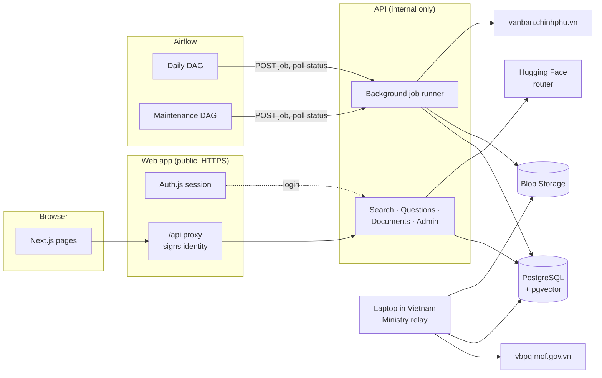
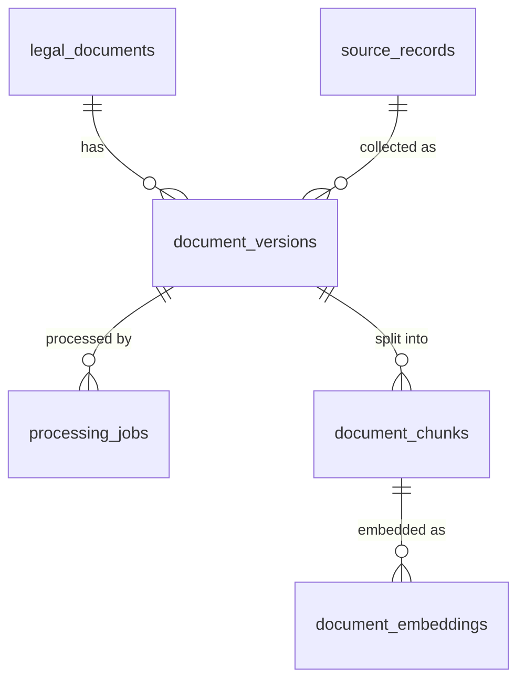
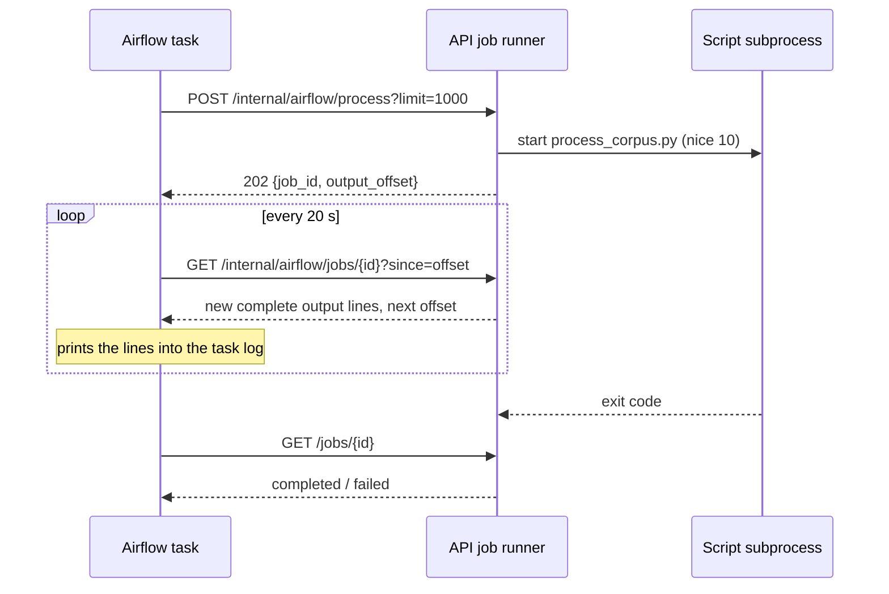
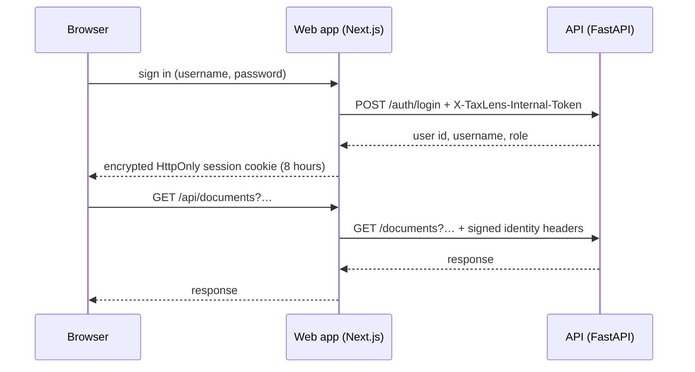

# Architecture

TaxLens is a modular monolith: one Python package (`src/taxlens`) behind a FastAPI
API, a Next.js web app in front of it, and Airflow scheduling the long-running work.
Everything runs on Azure Container Apps with PostgreSQL and Blob Storage holding all
durable state.



## Components

| Component | Code | Runs as | Notes |
| --- | --- | --- | --- |
| Web app | `apps/web` | Container App, public, 0.25 vCPU, scale to zero | Pages, sign-in, and an `/api/*` proxy. The browser never talks to the API directly. |
| API | `src/taxlens/api` | Container App, internal, 1 vCPU / 2 GiB, scale to zero, 1 replica | Request handling and background jobs share this container. The image contains Tesseract and the embedding model. |
| Airflow scheduler | `airflow/dags` | Container App, 1 replica always on | Runs DAGs; does no TaxLens work itself, only calls internal API jobs. |
| Airflow webserver | — | Container App, scale to zero | UI only. Reads task logs from the shared `airflow-logs` Azure Files share. |
| PostgreSQL | `migrations/` | Flexible Server `B_Standard_B1ms` | Application tables plus the `airflow` metadata database. |
| Blob Storage | `taxlens/storage` | Storage account | `raw-documents` (source files) and `normalized-text` (extracted text), plus evaluation reports. |

## Packages

```text
src/taxlens/
  api/                  FastAPI app, routes, auth, background job runner, startup migrations
  ingestion/            Source connectors (government portal, Ministry of Finance), ingestion
  document_processing/  Format detection, Word/RTF/DOCX/PDF text, OCR, legal-structure chunking
  retrieval/            Keyword search, embeddings, hybrid fusion, snippets
  intelligence/         Query planning, evidence gate, LangGraph Q&A, answer validation
  legal_data/           SQLAlchemy models, document numbers, document kinds
  evaluation/           Retrieval and Q&A metrics, MLflow tracking
  storage/              Local and Azure Blob object storage behind one interface
scripts/                Command-line jobs (collect, process, embed, evaluate, prune, benchmark)
```

Dependencies point one way: `api` → `intelligence` → `retrieval` → `legal_data`, and
`ingestion` / `document_processing` → `legal_data` + `storage`. The scripts call the same
functions the API uses; nothing is duplicated between the command line and the API.

## Data model



- **`legal_documents`**: one row per document number (`219/2013/TT-BTC`), with title,
  recorded type, and issuing agency. The type is kept as recorded; `document_kinds.py`
  groups the spellings (`TT-BTC`, `Thông tư`, `CIRCULAR`) into kinds for browsing.
- **`source_records`**: where a file came from (`government-portal` or `mof-vbpq`) and
  the source's own ID, which prevents downloading the same file twice.
- **`document_versions`**: one file of a document, identified by content hash, with issue
  date, effective date, and legal status (`EFFECTIVE`, `EXPIRED`, `DISCOVERED`, …).
- **`processing_jobs`**: extraction status per version (`COMPLETED`, `FAILED` with an
  error code) and the chunker version that produced its passages.
- **`document_chunks`**: article/clause passages of at most 1,500 characters with page
  range, heading, and two stored full-text vectors (accented and unaccented).
- **`document_embeddings`**: one 384-dimension `multilingual-e5-small` vector per chunk
  and model revision, with the hash of the text it was computed from.

Raw files and extracted text live in Blob Storage under
`source=<source>/year=<year>/document=<number>/<sha256>.<ext>`; the database stores the
key. A file's hash never changes, so re-processing never re-downloads.

## Request path

1. The browser calls `/api/<path>` on the web app.
2. The proxy (`apps/web/app/api/[...path]/route.ts`) checks the Auth.js session, strips
   any identity headers the browser sent, and adds a signed identity: user ID, username,
   role, timestamp, and an HMAC-SHA256 signature with `AUTH_INTERNAL_TOKEN`. Only the
   `documents`, `search`, `questions`, `evaluation`, and `admin` groups are forwarded.
3. The API checks the signature, rejects identities older than **300 seconds**, and
   confirms the account is still active. The window is longer than the 240-second ingress
   timeout, so a request that waited for a sleeping API is still accepted.
4. The web client retries reads (not questions) on 502/503/504 while a scaled-to-zero API
   starts, shows a "starting up" note after four seconds, and returns to the login page
   when the session itself has expired.

Details of sign-in and roles are in [Authentication](#authentication) below.

## Document library

The Documents tab never loads the whole corpus:

| Endpoint | Returns |
| --- | --- |
| `GET /documents/overview` | Totals (documents, searchable documents, passages, embedded passages, failed versions) and counts by source, kind, and legal status, in a handful of aggregate queries. |
| `GET /documents?limit=20&offset=…` | One page plus the total matching. Filters: `q` (number or title), `source_name`, `kind`, `document_type`, `legal_status`, `issuing_agency`. Newest issue date first. |
| `GET /documents/{id}` | Versions with status, processing result, and passage count. |
| `GET /documents/{id}/chunks?limit=50&offset=…` | Passages a page at a time. |

The page loads the overview and the first page in parallel, turns each count into a
filter chip, and keeps the current page and filters when returning from a document. All
labels, kinds, statuses, and source names are translated into Vietnamese.

## Background jobs

Collection, OCR, and embedding take minutes to hours; Container Apps closes any HTTP
request after 240 seconds. Jobs therefore run as subprocesses of the API
(`api/routes/internal_jobs.py`):



- **One job per request**: a POST returns at once; polling keeps the scale-to-zero API
  awake while the job runs.
- **Reattach, not duplicate**: a POST identical to a running job (same script and
  arguments) returns that job. A retried Airflow task, or two DAGs asking for the same
  embedding run, share one process.
- **Live output**: each poll returns only the output written since the last one, in
  complete lines, so progress appears in the Airflow log as it happens.
- **Lower priority**: jobs run under `nice 10`, so page requests are served first on the
  single vCPU.
- **Limits**: a job is killed after six hours. Jobs live in the API process, so an API
  restart (a deploy) loses them; the next poll gets 404 and Airflow retries.
- **Resumable work**: every script skips what is already done (collected files, processed
  versions, current embeddings) and commits as it goes, so a killed or retried job
  continues where it stopped.
- **Bounded memory**: embedding scans chunks 500 at a time and reads only their text and
  stored hash. Loading every chunk with its stored vector exceeded the 2 GiB container at
  about 40,000 chunks.

Internal endpoints require `X-TaxLens-Internal-Token` and are not reachable through the
web proxy. The Airflow DAGs are described in [pipeline.md](pipeline.md).

## Collection

Two official sources, both filtered to tax before anything is downloaded
([pipeline.md](pipeline.md)):

- **Government portal** (`vanban.chinhphu.vn`), tax category, 1988 onwards. Reachable from
  Azure; collected by Airflow daily (last 60 days) and by `backfill_corpus` (by year). A
  year that keeps timing out is skipped and retried by the next run.
- **Ministry of Finance** (`vbpq.mof.gov.vn`), with legal status and effective dates. It
  accepts Vietnamese IP addresses only, and Azure has no region in Vietnam, so it is
  collected from a laptop in Vietnam that writes straight to the Azure database and Blob
  Storage. Airflow then runs `process_and_embed` in Azure.

## Processing and retrieval

Text is read natively from Word, RTF, DOCX, and PDF text layers, and OCR'd with Tesseract
(`vie+eng`, 300 DPI) where a page has none. It is split along the legal structure
(*Điều* → *khoản*, or *Phần* / Roman-numeral sections in older documents). Search combines
diacritic-insensitive keyword ranking with semantic similarity by reciprocal rank fusion;
answers pass an evidence gate before any model call and are checked against the passages
they cite afterwards. The method and measured results are in
[retrieval.md](retrieval.md).

## Authentication

TaxLens has username and password accounts with two roles. The API is never exposed to
the browser: the web app signs every request it forwards.

### Request flow



- **Sign-in**: the Auth.js Credentials provider sends the credentials server-side to the
  API's internal login endpoint. Passwords are hashed with Argon2. Failed sign-ins are
  throttled per username (`AUTH_LOGIN_MAX_FAILURES` within
  `AUTH_LOGIN_FAILURE_WINDOW_SECONDS`), and unknown usernames take as long to reject as
  wrong passwords.
- **Session**: an encrypted, HttpOnly JWT cookie valid for eight hours. When it expires,
  the next request returns `Authentication required` and the page goes back to the login
  screen.
- **Signed identity**: for each request, the proxy (`apps/web/app/api/[...path]/route.ts`)
  removes any identity headers the browser sent and adds `X-TaxLens-User-Id`, `-Username`,
  `-Role`, `-Auth-Timestamp`, and `-Auth-Signature` (HMAC-SHA256 with
  `AUTH_INTERNAL_TOKEN`).
- **Verification**: the API checks the signature, rejects a timestamp more than 300
  seconds away from its clock (`Expired identity`), and confirms the account still exists,
  is active, and has the same role, on every request.
- **Reach**: the proxy forwards only `documents`, `search`, `questions`, `evaluation`, and
  `admin`. `/auth/*` and `/internal/*` are not reachable through it, and both also
  require their own service token.
- The browser never receives `HF_TOKEN`, database credentials, or the service tokens.

The 300-second window is longer than the 240-second ingress timeout. A request that waits
while a scaled-to-zero API starts is therefore still accepted; a 60-second window
rejected those requests as `Expired identity`.

### Roles and administration

Accounts are `admin` or `user`; there is no public sign-up. Administrators create,
disable, delete, and reset accounts at `/admin`. Questions are rate-limited per user
(`AUTH_RATE_LIMIT_PER_MINUTE`), in memory, which holds while the API runs as one replica.

### Local setup

Set these in `.env` (never commit them):

```dotenv
AUTH_INTERNAL_TOKEN=<long random secret>
NEXTAUTH_SECRET=<long random secret>
AUTH_INITIAL_ADMIN_USERNAME=admin
AUTH_INITIAL_ADMIN_PASSWORD=<at least 12 characters>
```

`python scripts/seed.py` creates the administrator when `AUTH_INITIAL_ADMIN_PASSWORD` is
set; it is idempotent. Sign in at `http://localhost:3000/login`.

### Azure

`AUTH_INTERNAL_TOKEN` and `NEXTAUTH_SECRET` are Key Vault secrets created by Terraform
and injected into the API and web containers through the managed identity.


## Azure deployment

The development environment runs in resource group `taxlens-dev-rg` (East Asia), managed
by Terraform in `infra/terraform` (`main.tf`, `airflow.tf`). Day-to-day procedures are in
[operations.md](operations.md).

### Resources

| Resource | Name | Size and scaling |
| --- | --- | --- |
| Web Container App | `taxlens-dev-web` | 0.25 vCPU, 0–1 replicas, public HTTPS |
| API Container App | `taxlens-dev-api` | 1 vCPU / 2 GiB, 0–1 replicas, internal only |
| Airflow scheduler | `taxlens-dev-airflow-scheduler` | 0.5 vCPU / 1 GiB, 1 replica |
| Airflow webserver | `taxlens-dev-airflow-web` | 0.5 vCPU / 1 GiB, 0–1 replicas |
| PostgreSQL Flexible Server | `taxlens-dev-pg` | `B_Standard_B1ms`, 32 GB, `vector` extension; databases `taxlens` and `airflow` |
| Storage account | `taxlensdevartifacts` | Blob containers `raw-documents`, `normalized-text`, `terraform-state`; file share `airflow-logs` |
| Container Registry | `taxlensdevacr` | Basic |
| Key Vault | `taxlensdevkv` | Application secrets, read by a user-assigned managed identity |
| Log Analytics | — | Console logs of all Container Apps |

Scale to zero keeps the environment cheap; the cost is a cold start of up to a minute
for the first request after idle. Only the Airflow scheduler is always on.

### Images

All images are tagged with the commit SHA and never reused.

- **API** (`apps/api/Dockerfile`): Python 3.12, Tesseract with `vie` and `eng`, the pinned
  `multilingual-e5-small` model (offline at runtime), the application, the job scripts,
  and the evaluation datasets. Dependencies are installed from
  `requirements/api-runtime.txt` before the source is copied, so a code change does not
  reinstall PyTorch. `OMP_THREAD_LIMIT=1` keeps Tesseract from contending for the single
  vCPU.
- **Web** (`apps/web/Dockerfile`): the Next.js app, built with the API's internal
  address (`http://taxlens-dev-api`).
- **Airflow** (`airflow/Dockerfile`): Airflow 2.10 with the DAG files baked in.

Build and publish them with the **Publish release images** workflow
([operations.md](operations.md#release)), not by hand.

### Startup and migrations

The API runs as a single replica and applies pending Alembic migrations itself, in a
background thread after uvicorn starts: `/health` answers the liveness probe at once and
`/ready` returns 503 until the schema is current. A failed migration keeps the revision
unready and logs `migrations_failed`.

### Configuration

Secrets come from Key Vault through the managed identity; everything else is a plain
environment variable set by Terraform.

| Setting | Purpose |
| --- | --- |
| `DATABASE_*`, `DATABASE_SSL_MODE=require` | PostgreSQL connection |
| `OBJECT_STORAGE_BACKEND=azure_blob`, `AZURE_STORAGE_ACCOUNT_URL`, `AZURE_STORAGE_CONTAINER`, `AZURE_STORAGE_NORMALIZED_CONTAINER` | Blob Storage through the managed identity |
| `HF_TOKEN` (secret), `HF_CHAT_BASE_URL`, `HF_CHAT_MODEL`, `HF_CHAT_ROUTING_POLICY` | Answer model. Any OpenAI-compatible endpoint works; set an empty routing policy for non-Hugging Face endpoints. |
| `AUTH_INTERNAL_TOKEN` (secret), `NEXTAUTH_SECRET` (secret) | Web-to-API identity signing and Auth.js sessions |
| `AIRFLOW_INTERNAL_TOKEN` (secret) | Airflow-to-API job calls |
| `TAXLENS_DAILY_SOURCE_LIMIT`, `TAXLENS_PROCESS_BATCH_SIZE`, `TAXLENS_PROCESS_MAX_BATCHES` | Daily DAG volumes |
| `OCR_*`, `EMBEDDING_*`, `QA_*` | Processing and retrieval settings; defaults in `src/taxlens/config.py` |

The Hugging Face router returns HTTP 402 when the account has no inference credits; every
answer is then `PROVIDER_UNAVAILABLE`, and the API logs
`chat_provider_error status=402`.

Terraform variables that hold secrets (`postgres_admin_password`, `hf_token`,
`auth_internal_token`, `nextauth_secret`, `airflow_admin_password`,
`airflow_internal_token`) come from GitHub secrets in the deploy workflow, or from an
ignored `terraform.tfvars` locally. See [operations.md](operations.md#terraform).

### Networking

The API has internal ingress only; the web app reaches it over the private Container
Apps network, and only the web app is public. PostgreSQL is public-network enabled with
Azure's `0.0.0.0` "Azure services" rule, because Container Apps egress IPs rotate, plus an
optional developer IP (`postgres_allowed_ip`) for laptop runs. This is a development
compromise.

### Before production

- Private networking (VNet integration, private endpoints for PostgreSQL and Storage);
  remove the Azure-services and developer firewall rules.
- More than one API replica, which needs a shared rate limiter (the current one is in
  memory) and moving jobs out of the API process.
- Processing in a Container Apps Job so OCR never shares CPU with requests.
- A paid inference endpoint with credits and monitoring.


## Design decisions

Also: PostgreSQL full-text search plus pgvector instead of a separate search service (one
database to run for tens of thousands of passages), and scale to zero everywhere except the
Airflow scheduler (development budget).

### Start with a modular monolith

#### Context

TaxLens needs ingestion, document processing, retrieval, question answering, and an API.
The corpus (thousands of documents) and traffic (a few users) do not justify distributed
services.

#### Decision

Build one Python package with explicit module boundaries (`ingestion`,
`document_processing`, `retrieval`, `intelligence`, `legal_data`, `storage`, `api`). Long
work runs as command-line scripts that call the same functions as the API. Airflow
schedules those scripts through an authenticated API job boundary
([below](#run-long-jobs-inside-the-api-polled-by-airflow)) rather than containing its own logic.

#### Consequences

The project is simple to run, test, and deploy. Module contracts must stay clean so a
separate worker could later call the same functions without copying business logic.

#### Revisit trigger

Processing measurably slows user requests, or the corpus or traffic outgrows one API
replica.

### Run long jobs inside the API, polled by Airflow

#### Context

Collection, OCR, and embedding take from minutes to several hours. They need Tesseract
and the embedding model, which are already in the API image. Azure Container Apps
closes HTTP requests after 240 seconds, and the API scales to zero when idle.

The first design had each Airflow task hold one HTTP request open for the whole job.
Any job longer than 240 seconds (OCR of a single long scan) failed, and the API then
scaled down and killed the orphaned process.

#### Decision

The API starts each job as a subprocess and returns a job ID at once. Airflow polls the
job every 20 seconds, printing new output lines into the task log, until it completes or
fails. An identical request to a running job reattaches to it. Jobs run at lower CPU
priority than requests and are limited to six hours.

#### Consequences

- No extra always-on worker; the API image stays the only place with OCR and the model.
- Polling keeps the API awake during a job, so scale-to-zero needs no special handling.
- Jobs share the API's single vCPU and 2 GiB of memory with web requests, so job code
  must keep memory bounded (embedding pages through chunks instead of loading them all).
- An API restart loses running jobs. Every script is resumable, so Airflow's retry
  continues the work.
- Two different jobs can run at once (the daily DAG and a maintenance run); avoid
  overlapping long backfills with the 10:00 (+07) daily run.

#### Revisit trigger

Jobs regularly approach six hours, or OCR load makes the site noticeably slow. The next
step is a Container Apps Job running the same image and scripts.

### Collect the Ministry of Finance database from a machine in Vietnam

#### Context

The Ministry of Finance database (`vbpq.mof.gov.vn`) is the best tax source: it records
legal status and effective dates, and about half its files are Word documents that need
no OCR. From Azure (East Asia, Hong Kong) its TCP connections time out, while the same
API answers in seconds from a Vietnamese network. The site appears to accept Vietnamese
IP addresses only, and Azure has no region in Vietnam.

#### Decision

Ministry collection runs from a laptop in Vietnam, writing directly to the Azure
PostgreSQL database and Blob Storage (`collect_sources.py --source mof`). It only lists
and downloads; OCR and embedding then run in Azure through the `process_and_embed`
maintenance action. Airflow collects only from the government portal, which is reachable
from Azure.

#### Consequences

- No proxy or VPN to pay for or maintain.
- New Ministry documents are not collected automatically; someone runs the command
  occasionally. Recent documents still arrive daily through the government portal.
- The laptop's public IP must be allowed in the PostgreSQL firewall during the run, and
  the rule should be removed afterwards.
- The script checks the database and storage before its ten-minute listing, caches the
  listing for 24 hours, and tolerates a dropped connection per document.

#### Revisit trigger

Ministry updates need to be automatic. The alternative is a small proxy hosted in
Vietnam that Airflow's collection job calls.
