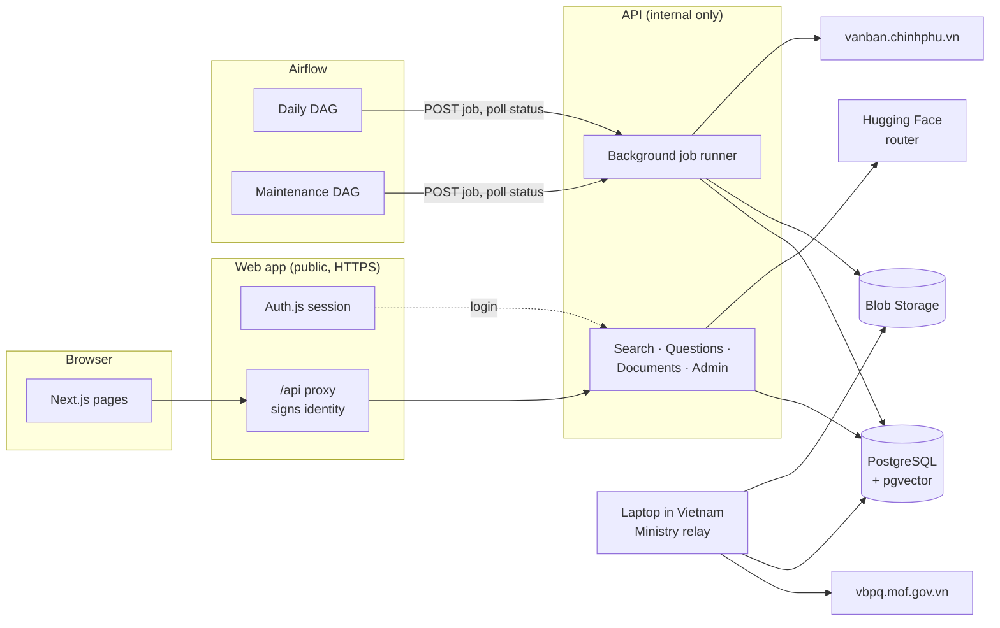
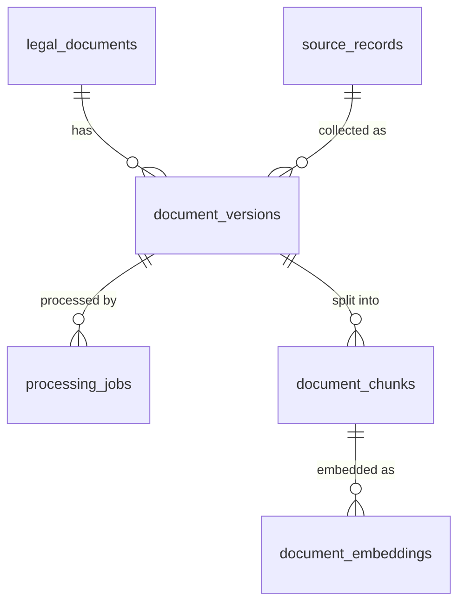
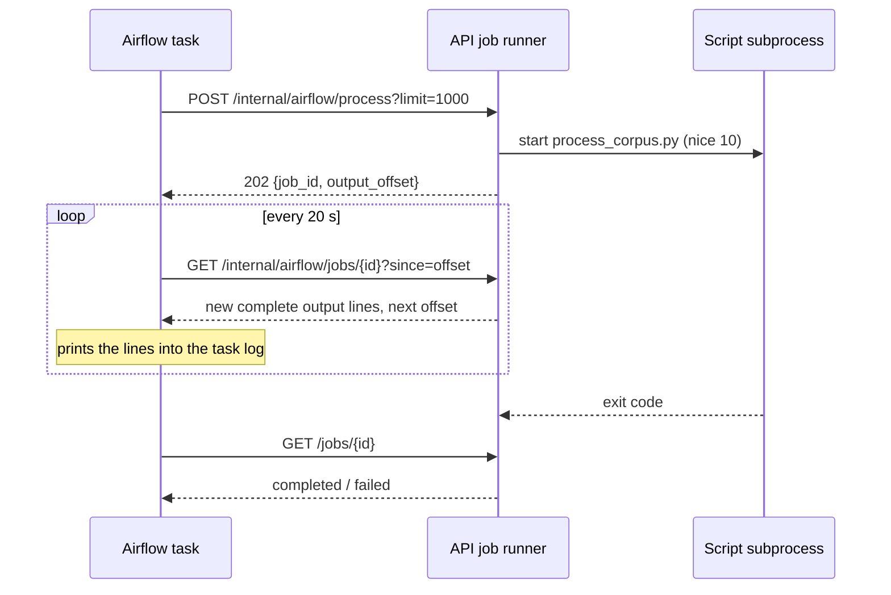

# Architecture

TaxLens is a modular monolith: one Python package (`src/taxlens`) behind a FastAPI
API, a Next.js web app in front of it, and Airflow scheduling the long-running work.
Everything runs on Azure Container Apps with PostgreSQL and Blob Storage holding all
durable state.



## Components

| Component | Code | Runs as | Notes |
| --- | --- | --- | --- |
| Web app | `apps/web` | Container App, public, 0.25 vCPU, scale to zero | Pages, sign-in, and an `/api/*` proxy. The browser never talks to the API directly. |
| API | `src/taxlens/api` | Container App, internal, 1 vCPU / 2 GiB, scale to zero, 1 replica | Request handling and background jobs share this container. The image contains Tesseract and the embedding model. |
| Airflow scheduler | `airflow/dags` | Container App, 1 replica always on | Runs DAGs; does no TaxLens work itself, only calls internal API jobs. |
| Airflow webserver | — | Container App, scale to zero | UI only. Reads task logs from the shared `airflow-logs` Azure Files share. |
| PostgreSQL | `migrations/` | Flexible Server `B_Standard_B1ms` | Application tables plus the `airflow` metadata database. |
| Blob Storage | `taxlens/storage` | Storage account | `raw-documents` (source files) and `normalized-text` (extracted text), plus evaluation reports. |

## Packages

```text
src/taxlens/
  api/                  FastAPI app, routes, auth, background job runner, startup migrations
  ingestion/            Source connectors (government portal, Ministry of Finance), ingestion
  document_processing/  Format detection, Word/RTF/DOCX/PDF text, OCR, legal-structure chunking
  retrieval/            Keyword search, embeddings, hybrid fusion, snippets
  intelligence/         Query planning, evidence gate, LangGraph Q&A, answer validation
  legal_data/           SQLAlchemy models, document numbers, document kinds
  evaluation/           Retrieval and Q&A metrics, MLflow tracking
  storage/              Local and Azure Blob object storage behind one interface
scripts/                Command-line jobs (collect, process, embed, evaluate, prune, benchmark)
```

Dependencies point one way: `api` → `intelligence` → `retrieval` → `legal_data`, and
`ingestion` / `document_processing` → `legal_data` + `storage`. The scripts call the same
functions the API uses; nothing is duplicated between the command line and the API.

## Data model



- **`legal_documents`**: one row per document number (`219/2013/TT-BTC`), with title,
  recorded type, and issuing agency. The type is kept as recorded; `document_kinds.py`
  groups the spellings (`TT-BTC`, `Thông tư`, `CIRCULAR`) into kinds for browsing.
- **`source_records`**: where a file came from (`government-portal` or `mof-vbpq`) and
  the source's own ID, which prevents downloading the same file twice.
- **`document_versions`**: one file of a document, identified by content hash, with issue
  date, effective date, and legal status (`EFFECTIVE`, `EXPIRED`, `DISCOVERED`, …).
- **`processing_jobs`**: extraction status per version (`COMPLETED`, `FAILED` with an
  error code) and the chunker version that produced its passages.
- **`document_chunks`**: article/clause passages of at most 1,500 characters with page
  range, heading, and two stored full-text vectors (accented and unaccented).
- **`document_embeddings`**: one 384-dimension `multilingual-e5-small` vector per chunk
  and model revision, with the hash of the text it was computed from.

Raw files and extracted text live in Blob Storage under
`source=<source>/year=<year>/document=<number>/<sha256>.<ext>`; the database stores the
key. A file's hash never changes, so re-processing never re-downloads.

## Request path

1. The browser calls `/api/<path>` on the web app.
2. The proxy (`apps/web/app/api/[...path]/route.ts`) checks the Auth.js session, strips
   any identity headers the browser sent, and adds a signed identity: user ID, username,
   role, timestamp, and an HMAC-SHA256 signature with `AUTH_INTERNAL_TOKEN`. Only the
   `documents`, `search`, `questions`, `evaluation`, and `admin` groups are forwarded.
3. The API checks the signature, rejects identities older than **300 seconds**, and
   confirms the account is still active. The window is longer than the 240-second ingress
   timeout, so a request that waited for a sleeping API is still accepted.
4. The web client retries reads (not questions) on 502/503/504 while a scaled-to-zero API
   starts, shows a "starting up" note after four seconds, and returns to the login page
   when the session itself has expired.

Details of sign-in and roles are in [authentication.md](authentication.md).

## Document library

The Documents tab never loads the whole corpus:

| Endpoint | Returns |
| --- | --- |
| `GET /documents/overview` | Totals (documents, searchable documents, passages, embedded passages, failed versions) and counts by source, kind, and legal status, in a handful of aggregate queries. |
| `GET /documents?limit=20&offset=…` | One page plus the total matching. Filters: `q` (number or title), `source_name`, `kind`, `document_type`, `legal_status`, `issuing_agency`. Newest issue date first. |
| `GET /documents/{id}` | Versions with status, processing result, and passage count. |
| `GET /documents/{id}/chunks?limit=50&offset=…` | Passages a page at a time. |

The page loads the overview and the first page in parallel, turns each count into a
filter chip, and keeps the current page and filters when returning from a document. All
labels, kinds, statuses, and source names are translated into Vietnamese.

## Background jobs

Collection, OCR, and embedding take minutes to hours; Container Apps closes any HTTP
request after 240 seconds. Jobs therefore run as subprocesses of the API
(`api/routes/internal_jobs.py`):



- **One job per request**: a POST returns at once; polling keeps the scale-to-zero API
  awake while the job runs.
- **Reattach, not duplicate**: a POST identical to a running job (same script and
  arguments) returns that job. A retried Airflow task, or two DAGs asking for the same
  embedding run, share one process.
- **Live output**: each poll returns only the output written since the last one, in
  complete lines, so progress appears in the Airflow log as it happens.
- **Lower priority**: jobs run under `nice 10`, so page requests are served first on the
  single vCPU.
- **Limits**: a job is killed after six hours. Jobs live in the API process, so an API
  restart (a deploy) loses them; the next poll gets 404 and Airflow retries.
- **Resumable work**: every script skips what is already done (collected files, processed
  versions, current embeddings) and commits as it goes, so a killed or retried job
  continues where it stopped.
- **Bounded memory**: embedding scans chunks 500 at a time and reads only their text and
  stored hash. Loading every chunk with its stored vector exceeded the 2 GiB container at
  about 40,000 chunks.

Internal endpoints require `X-TaxLens-Internal-Token` and are not reachable through the
web proxy. The Airflow DAGs are described in [airflow.md](airflow.md).

## Collection

Two official sources, both filtered to tax before anything is downloaded
([sources.md](sources.md)):

- **Government portal** (`vanban.chinhphu.vn`), tax category, 1988 onwards. Reachable from
  Azure; collected by Airflow daily (last 60 days) and by `backfill_corpus` (by year). A
  year that keeps timing out is skipped and retried by the next run.
- **Ministry of Finance** (`vbpq.mof.gov.vn`), with legal status and effective dates. It
  accepts Vietnamese IP addresses only, and Azure has no region in Vietnam, so it is
  collected from a laptop in Vietnam that writes straight to the Azure database and Blob
  Storage. Airflow then runs `process_and_embed` in Azure.

## Processing and retrieval

Text is read natively from Word, RTF, DOCX, and PDF text layers, and OCR'd with Tesseract
(`vie+eng`, 300 DPI) where a page has none. It is split along the legal structure
(*Điều* → *khoản*, or *Phần* / Roman-numeral sections in older documents). Search combines
diacritic-insensitive keyword ranking with semantic similarity by reciprocal rank fusion;
answers pass an evidence gate before any model call and are checked against the passages
they cite afterwards. The method and measured results are in
[retrieval.md](retrieval.md).

## Design decisions

| Decision | Why | Record |
| --- | --- | --- |
| One Python package, no microservices | Small team and traffic; clean module boundaries are enough | [ADR 0001](adr/0001-modular-monolith.md) |
| Jobs as API subprocesses, polled by Airflow | Reuses the API image (Tesseract, model), no extra always-on worker cost, survives the 240 s ingress limit | [ADR 0002](adr/0002-background-jobs-in-the-api.md) |
| Ministry of Finance collected from a laptop | The source rejects non-Vietnamese IPs; a laptop run costs nothing | [ADR 0003](adr/0003-ministry-relay.md) |
| PostgreSQL full-text + pgvector, no search service | One database to run; the corpus is tens of thousands of passages | [retrieval.md](retrieval.md) |
| Scale to zero everywhere except the Airflow scheduler | Student-budget development environment | [deployment.md](deployment.md) |
