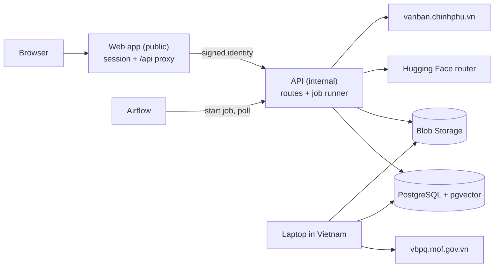

# Architecture

A modular monolith: one Python package (`src/taxlens`) behind a FastAPI API, a Next.js web app in front,
and Airflow scheduling long work, on Azure Container Apps with PostgreSQL and Blob Storage.



## Packages

```text
src/taxlens/
  api/                  FastAPI app, routes, auth, job runner, startup migrations
  ingestion/            Source connectors, ingestion
  document_processing/  Format detection, Word/RTF/DOCX/PDF text, OCR, chunking
  retrieval/            Keyword search, embeddings, fusion, snippets, repeals, issues
  intelligence/         Query planning, evidence gate, LangGraph Q&A, validation
  legal_data/           SQLAlchemy models, document numbers and kinds
  evaluation/           Metrics, gold set, comparisons, MLflow tracking
  storage/              Local and Azure Blob storage behind one interface
scripts/                Command-line jobs calling the same functions
```

Dependencies point one way: `api` → `intelligence` → `retrieval` → `legal_data`, and `ingestion` and
`document_processing` → `legal_data` + `storage`.

## Data model

- **`legal_documents`**: one row per document number, with title, type, and agency.
- **`source_records`**: where a file came from, and the source's ID, which prevents repeat downloads.
- **`document_versions`**: one file, by content hash, with dates and status (`EFFECTIVE`, `EXPIRED`,
  `DISCOVERED`). A number can hold several.
- **`processing_jobs`**: extraction status per version, error code, and chunker version.
- **`document_chunks`**: passages up to 1,500 characters, with article, clause, pages, heading, and two
  `tsvector` columns.
- **`document_embeddings`**: a 384-dimension vector per chunk and model revision, with its text hash.

Raw files and text are in Blob Storage at `source=<source>/year=<year>/document=<slug>/<sha256>.<ext>`.

## Web and API

The browser calls `/api/<path>` on the web app. The proxy (`apps/web/app/api/[...path]/route.ts`) checks the
session and forwards with a signed identity. The client retries reads, never questions, on 502, 503, or
504 while the API starts. "The service could not be reached" means the browser got no response at all;
"The **API** service could not be reached" means the proxy failed to reach the API.

- **Search tab:** `GET /documents?q=` for number or title matches (not accent-insensitive) and
  `GET /search` for passages, ten a page, over the top 200, with source, kind, and status chips.
- **Documents tab:** administrators only. `GET /documents/overview`, `/documents`, `/documents/{id}`, and
  `/{id}/chunks`, all paged.
- **Administrators:** accounts at `/admin`, and `GET /admin/documents/export` for a metadata CSV.
- **Everything else:** `POST /questions`, `GET /evaluation/retrieval/latest`, `/health`, `/ready`, and
  `/internal/airflow/*` with `X-TaxLens-Internal-Token`.

## Authentication

Username and password accounts, `admin` or `user`, with no public sign-up.

- **Sign-in:** Auth.js sends credentials server-side to the API's internal login. Passwords use Argon2,
  and failures are throttled per username.
- **Session:** encrypted HttpOnly cookie for 8 hours, then back to the login page.
- **Signed identity:** the proxy removes any identity headers from the browser and adds user, role,
  timestamp, and an HMAC-SHA256 signature with `AUTH_INTERNAL_TOKEN`.
- **Verification:** the API checks the signature, a timestamp within 300 s (longer than the 240 s ingress
  limit, so a cold start is accepted), and that the account is active with the same role.
- **Reach:** the proxy forwards only `documents`, `search`, `questions`, `evaluation`, and `admin`.
- Questions are rate-limited per user in memory, which needs one API replica.

## Background jobs

Container Apps closes requests after 240 s, so jobs run as subprocesses of the API
(`api/routes/internal_jobs.py`). A POST returns a job ID at once, and Airflow polls every 20 s, printing new
output.

- An identical POST reattaches to the running job.
- Jobs run under `nice 10` and are killed after six hours. An API restart loses them, so **never release
  during a run**.
- Scripts skip finished work and commit as they go, so retries resume.
- Embedding pages through 500 chunks at a time, to stay within 2 GiB.

## Azure

Resource group `taxlens-dev-rg`, East Asia, by Terraform in `infra/terraform`.

| Resource | Name | Size |
| --- | --- | --- |
| Web | `taxlens-dev-web` | 0.25 vCPU, 0-1 replicas, public |
| API | `taxlens-dev-api` | 1 vCPU, 2 GiB, 0-1 replicas, internal |
| Airflow scheduler | `taxlens-dev-airflow-scheduler` | 0.5 vCPU, 1 GiB, always on unless stopped |
| Airflow webserver | `taxlens-dev-airflow-web` | 0.5 vCPU, 1 GiB, 0-1 replicas |
| PostgreSQL | `taxlens-dev-pg` | `B_Standard_B1ms`, 32 GB, `vector`; databases `taxlens`, `airflow` |
| Storage | `taxlensdevartifacts` | `raw-documents`, `normalized-text`, `terraform-state`, `airflow-logs` |
| Registry | `taxlensdevacr` | Basic |
| Key Vault | `taxlensdevkv` | Secrets, read by a managed identity |
| Log Analytics | | Console logs of all apps |

**Images** are tagged by commit SHA. The API image holds Tesseract, the pinned embedding model, scripts, and
evaluation data. Dependencies install from `requirements/api-runtime.txt` before the source is copied.

**Startup:** the API applies Alembic migrations in a background thread. `/health` answers at once and
`/ready` returns 503 until the schema is current.

**Configuration:** secrets come from Key Vault; the rest are environment variables from Terraform, with
defaults in `src/taxlens/config.py`. The API sets no `HF_CHAT_*` values, so **the model is the code default**,
and `.env` affects only local runs. Default: `google/gemma-3-27b-it`, `fastest` routing, 90 s timeout, 2,000
output tokens. Any OpenAI-compatible endpoint works, with an empty routing policy.

**Networking:** only the web app is public. PostgreSQL allows Azure services, plus developer IPs. This is a
development compromise. Production would need private endpoints, more API replicas with a shared rate
limiter, and jobs moved out of the API process.

## Design decisions

| Decision | Why | Revisit when |
| --- | --- | --- |
| Modular monolith | Thousands of documents and a few users do not justify services | Processing slows requests, or traffic outgrows one replica |
| Long jobs in the API, polled by Airflow | The API image already has OCR and the model. Holding a request open failed at 240 s | Jobs near six hours; then use a Container Apps Job |
| Ministry collected from a laptop in Vietnam | The site accepts Vietnamese IPs only, and Azure has no region there. No proxy to pay for, but it is manual | Updates must be automatic; then use a proxy in Vietnam |
| PostgreSQL full-text + pgvector | One database to run | Search needs outgrow it |
| Scale to zero, except the scheduler | Budget. The cost is a cold start | Budget allows a kept replica |
