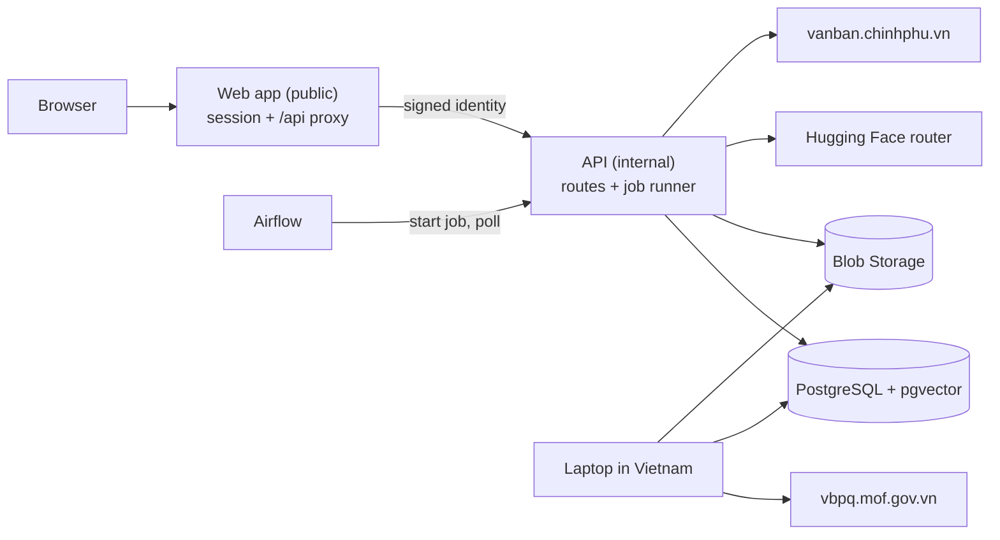
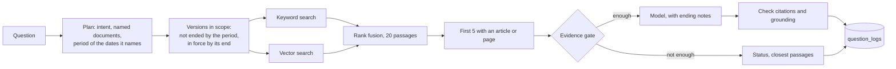

# Architecture

A modular monolith: one Python package (`src/taxlens`) behind a FastAPI API, a Next.js web app in front,
and Airflow scheduling long work, on Azure Container Apps with PostgreSQL and Blob Storage.



## Packages

```text
src/taxlens/
  api/                  FastAPI app, routes, auth, job runner, startup migrations
  ingestion/            Source connectors, ingestion
  document_processing/  Format detection, Word/RTF/DOCX/PDF text, OCR, chunking
  retrieval/            Keyword and vector search, fusion, snippets, citations, ended documents (repeals)
  intelligence/         Query planning (period, filters), evidence gate, LangGraph Q&A, model calls
  legal_data/           SQLAlchemy models, document numbers and kinds
  evaluation/           Metrics, gold set, comparisons, reports, MLflow tracking
  storage/              Local and Azure Blob storage behind one interface
  spreadsheets.py       Formula-safe cells for CSV exports
apps/web/
  app/                  Pages (workspace, login, admin), Auth.js, the /api proxy
  components/           Answer card and feedback, tags, document views, icons, layout
  lib/                  Types, interface text (EN/VI), formatting, API calls
  tests/                Vitest unit tests
scripts/                Command-line jobs calling the same functions
```

Dependencies point one way: `api` → `intelligence` → `retrieval` → `legal_data`, and `ingestion` and
`document_processing` → `legal_data` + `storage`.

## How a question is answered



The period comes from the dates a question names ("Tháng 6/2023"), or today in Vietnam time. Ended
documents and the filters are resolved to a list of version ids first, in one small query, and both
searches run against that list ([why](#design-decisions)). Details and thresholds are in
[retrieval.md](retrieval.md).

## Data model

- **`legal_documents`**: one row per document number, with title, type, and agency, and its recorded
  ending (`ended_on`, `end_basis`, `ended_by`; see [ended documents](retrieval.md#ended-documents)).
- **`source_records`**: where a file came from, and the source's ID, which prevents repeat downloads.
- **`document_versions`**: one file, by content hash, with dates and status (`EFFECTIVE`, `EXPIRED`,
  `DISCOVERED`). A number can hold several, though `corpus-v2.1` holds one each.
- **`processing_jobs`**: extraction status per version, error code, and chunker version.
- **`document_chunks`**: passages up to 1,500 characters, with article, clause, pages, heading, and two
  `tsvector` columns.
- **`document_embeddings`**: a 384-dimension vector per chunk and model revision, with its text hash.
- **`question_logs`**: each question asked on the site, its status, answer, cited documents, and time
  taken, with the asker's 👍/👎 and comment.

Raw files and text are in Blob Storage at `source=<source>/year=<year>/document=<slug>/<sha256>.<ext>`.
`corpus-v2.1` holds 2,986 documents and 144,279 passages, all embedded.

## Web and API

The browser calls `/api/<path>` on the web app. The proxy (`apps/web/app/api/[...path]/route.ts`) checks the
session and forwards with a signed identity. The client retries reads, never questions, on 502, 503, or
504 while the API starts. "The service could not be reached" means the browser got no response at all;
"The **API** service could not be reached" means the proxy failed to reach the API.

- **Search tab:** `GET /documents?q=` for number or title matches (not accent-insensitive) and
  `GET /search` for passages, ten a page, over the top 200, with source, kind, and status chips.
- **Ask tab:** `POST /questions` returns the answer and its log id; `POST /questions/{id}/feedback` records
  👍/👎 and a comment, from the asker only.
- **Documents tab:** administrators only. `GET /documents/overview`, `/documents`, `/documents/{id}`, and
  `/{id}/chunks`, all paged.
- **Administrators:** accounts at `/admin`, and `GET /admin/documents/export` for a metadata CSV.
- **Everything else:** `GET /evaluation/retrieval/latest`, `/health`, `/ready`, and `/internal/airflow/*`
  with `X-TaxLens-Internal-Token`.

**Interface.** English and Vietnamese, with the page language following the switch. Be Vietnam Pro and
Source Serif 4 are self-hosted with their Vietnamese subsets (`next/font`), so both languages share one
typeface. Every control has a visible focus ring and, on touch screens, a 44 px target; text meets WCAG AA
contrast; a status line announces results to screen readers; icons are inline SVG. Citations, search
results, and the library tag ended documents ("Ended 01/07/2022 · by 78/2021/TT-BTC").

## Authentication

Username and password accounts, `admin` or `user`, with no public sign-up.

- **Sign-in:** Auth.js sends credentials server-side to the API's internal login. Passwords use Argon2,
  and failures are throttled per username. The form posts, so a password never reaches a URL.
- **Session:** encrypted HttpOnly cookie for 8 hours, then back to the login page.
- **Signed identity:** the proxy removes any identity headers from the browser and adds user, role,
  timestamp, and an HMAC-SHA256 signature with `AUTH_INTERNAL_TOKEN`.
- **Verification:** the API checks the signature, a timestamp within 300 s (longer than the 240 s ingress
  limit, so a cold start is accepted), and that the account is active with the same role.
- **Reach:** the proxy forwards only `documents`, `search`, `questions`, `evaluation`, and `admin`.
- Questions are rate-limited per user in memory, which needs one API replica.

## Logging

The API writes plain-text logs to Log Analytics; each answer records where its time went:

| Line | What it gives |
| --- | --- |
| `eligible_versions count= seconds=` | Versions in scope after the filters |
| `keyword_query rows= seconds=`, `semantic_query rows= seconds=` | Each search's database time |
| `hybrid_search keyword_seconds= embed_seconds= semantic_seconds= keyword_terms=` | The search as a whole |
| `retrieval_completed seconds= candidates= located= current_on= as_of=` | Retrieval and the period used |
| `model_call model= provider= latency_ms= input_tokens= output_tokens= outcome=` | The model call |
| `question_logged id= status= seconds=`, `question_rated id= rating=` | The log entry and its rating |

A warm answer takes about 5.5 s: retrieval about 4 s (keyword search the larger part) and the model about
1.5 s. How to read the logs is in [operations.md](operations.md#logs).

## Background jobs

Container Apps closes requests after 240 s, so jobs run as subprocesses of the API
(`api/routes/internal_jobs.py`). A POST returns a job ID at once, and Airflow polls every 20 s, printing new
output.

- An identical POST reattaches to the running job.
- Jobs run under `nice 10` and are killed after six hours. An API restart loses them, so **never release
  during a run**.
- Scripts skip finished work and commit as they go, so retries resume.
- Embedding pages through 500 chunks at a time, to stay within 2 GiB.

## Azure

Resource group `taxlens-dev-rg`, East Asia, by Terraform in `infra/terraform`.

| Resource | Name | Size |
| --- | --- | --- |
| Web | `taxlens-dev-web` | 0.25 vCPU, 0-1 replicas, public |
| API | `taxlens-dev-api` | 1 vCPU, 2 GiB, 0-1 replicas, internal; scales to zero after 10 idle minutes |
| Airflow scheduler | `taxlens-dev-airflow-scheduler` | 0.5 vCPU, 1 GiB, always on unless stopped |
| Airflow webserver | `taxlens-dev-airflow-web` | 0.5 vCPU, 1 GiB, 0-1 replicas |
| PostgreSQL | `taxlens-dev-pg` | `B_Standard_B1ms` (1 vCore, 2 GB), 32 GB, pgvector 0.8; databases `taxlens`, `airflow` |
| Storage | `taxlensdevartifacts` | `raw-documents`, `normalized-text`, `terraform-state`, `airflow-logs` |
| Registry | `taxlensdevacr` | Basic; each release keeps the 2 newest images |
| Key Vault | `taxlensdevkv` | Secrets, read by a managed identity |
| Log Analytics | | Console and system logs of all apps |

**Images** are tagged by commit SHA. The API image (0.77 GB) holds Tesseract, the pinned embedding model
(its safetensors weights only), scripts, and evaluation data. Dependencies install from
`requirements/api-runtime.txt` before the source is copied. A cold start pulls the image in about 13 s,
then loads the model.

**Startup:** the API applies Alembic migrations in a background thread. `/health` answers at once and
`/ready` returns 503 until the schema is current.

**Configuration:** secrets come from Key Vault; the rest are environment variables from Terraform, with
defaults in `src/taxlens/config.py`. The API sets no `HF_CHAT_*` values, so **the model is the code default**,
and `.env` affects only local runs. Default: `openai/gpt-oss-120b`, `fastest` routing, 90 s timeout, 3,000
output tokens. Any OpenAI-compatible endpoint works, with an empty routing policy.

**Networking:** only the web app is public. PostgreSQL allows Azure services, plus developer IPs. This is a
development compromise. Production would need private endpoints, more API replicas with a shared rate
limiter, and jobs moved out of the API process.

## Delivery

- **CI** (`.github/workflows/ci.yml`, every push): backend ruff, mypy, and pytest; web lint (ESLint with
  Next's rules), Vitest, and the production build; Terraform format and validation.
- **Release** (`release.yml`, run by hand on `main`): builds the API, web, and Airflow images, then plans and
  applies Terraform. With `build` off and an `image_tag`, it applies settings or rolls back without
  building. Steps are in [operations.md](operations.md#release).

## Design decisions

| Decision | Why | Revisit when |
| --- | --- | --- |
| Modular monolith | Thousands of documents and a few users do not justify services | Processing slows requests, or traffic outgrows one replica |
| Long jobs in the API, polled by Airflow | The API image already has OCR and the model. Holding a request open failed at 240 s | Jobs near six hours; then use a Container Apps Job |
| Ministry collected from a laptop in Vietnam | The site accepts Vietnamese IPs only, and Azure has no region there. No proxy to pay for, but it is manual | Updates must be automatic; then use a proxy in Vietnam |
| PostgreSQL full-text + pgvector, exact vector search | One database to run; an HNSW index could silently drop filtered results | Search needs outgrow it, or pgvector's iterative scans prove equal in evaluation |
| Filters resolved to version ids before searching | Joined into the passage scans, the ended-document and date filters led to plans 3-5 times slower | The version count grows past a few tens of thousands |
| Ended documents stored on `legal_documents`, compared with today per request | One list, loaded from a committed file; a future ending takes effect without a release | Endings come from a maintained source |
| Only confirmed endings leave answers; inferred ones are flagged | No legal expert has validated the inference rules | An expert validates them |
| Every question logged, with optional rating | Real questions are the cheapest source of gold cases | Privacy rules require less |
| Self-hosted fonts with the Vietnamese subset | One typeface in both languages, no request to Google at runtime | Never, unless the design changes |
| Scale to zero after 10 idle minutes, except the scheduler | Budget; an idle API costs about $0.03 an hour. The cost is a cold start of about a minute | Budget allows a kept replica |
