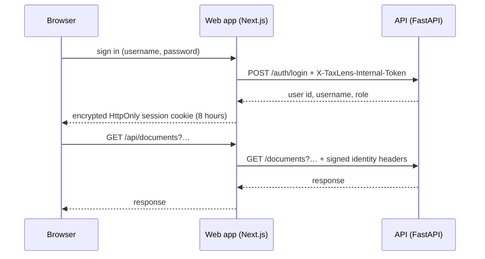

# Authentication and authorization

TaxLens has username and password accounts with two roles. The API is never exposed to
the browser: the web app signs every request it forwards.

## Request flow



- **Sign-in**: the Auth.js Credentials provider sends the credentials server-side to the
  API's internal login endpoint. Passwords are hashed with Argon2. Failed sign-ins are
  throttled per username (`AUTH_LOGIN_MAX_FAILURES` within
  `AUTH_LOGIN_FAILURE_WINDOW_SECONDS`), and unknown usernames take as long to reject as
  wrong passwords.
- **Session**: an encrypted, HttpOnly JWT cookie valid for eight hours. When it expires,
  the next request returns `Authentication required` and the page goes back to the login
  screen.
- **Signed identity**: for each request, the proxy (`apps/web/app/api/[...path]/route.ts`)
  removes any identity headers the browser sent and adds `X-TaxLens-User-Id`, `-Username`,
  `-Role`, `-Auth-Timestamp`, and `-Auth-Signature` (HMAC-SHA256 with
  `AUTH_INTERNAL_TOKEN`).
- **Verification**: the API checks the signature, rejects a timestamp more than 300
  seconds away from its clock (`Expired identity`), and confirms the account still exists,
  is active, and has the same role, on every request.
- **Reach**: the proxy forwards only `documents`, `search`, `questions`, `evaluation`, and
  `admin`. `/auth/*` and `/internal/*` are not reachable through it, and both also
  require their own service token.
- The browser never receives `HF_TOKEN`, database credentials, or the service tokens.

The 300-second window is longer than the 240-second ingress timeout. A request that waits
while a scaled-to-zero API starts is therefore still accepted; a 60-second window
rejected those requests as `Expired identity`.

## Roles and administration

Accounts are `admin` or `user`; there is no public sign-up. Administrators create,
disable, delete, and reset accounts at `/admin`. Questions are rate-limited per user
(`AUTH_RATE_LIMIT_PER_MINUTE`), in memory, which holds while the API runs as one replica.

## Local setup

Set these in `.env` (never commit them):

```dotenv
AUTH_INTERNAL_TOKEN=<long random secret>
NEXTAUTH_SECRET=<long random secret>
AUTH_INITIAL_ADMIN_USERNAME=admin
AUTH_INITIAL_ADMIN_PASSWORD=<at least 12 characters>
```

`python scripts/seed.py` creates the administrator when `AUTH_INITIAL_ADMIN_PASSWORD` is
set; it is idempotent. Sign in at `http://localhost:3000/login`.

## Azure

`AUTH_INTERNAL_TOKEN` and `NEXTAUTH_SECRET` are Key Vault secrets created by Terraform
and injected into the API and web containers through the managed identity.
