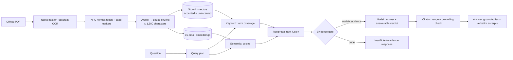

# Retrieval and cited answers

This document describes how TaxLens turns official documents into passages, how it finds
the passages for a question, and how it decides whether an answer can be given and
cited. Every step is deterministic except the language model call, and every threshold
named here is a setting.



## 1. Text extraction

The decision is made per page: a page keeps its PDF text layer when that text is usable
(at least 40 non-space characters, at least 20% letters), and only the other pages are
rendered and OCR'd with Tesseract `vie+eng`. In practice the government portal publishes
scans, so nearly every page is OCR text.

OCR settings (`OCR_DPI`, `OCR_PAGE_SEGMENTATION_MODE`, `OCR_TIMEOUT_SECONDS`):

- **300 DPI** rendering (previously about 144 DPI). Vietnamese diacritics are small marks
  and Tesseract is trained for about 300 DPI.
- **Page segmentation mode 6** (one uniform text block), which measured best.
- **Grayscale** rendering and `OMP_THREAD_LIMIT=1`, since Tesseract's threads only contend
  on the API's single vCPU.
- A page that times out is left empty instead of failing the whole document.

The `ocr_benchmark` action of the `taxlens_corpus_maintenance` DAG
(`scripts/benchmark_ocr.py`) measures word error rate, with and without diacritics,
against a born-digital PDF. On three pages of 301/2026/NĐ-CP:

| DPI | Mode | Word error rate | Ignoring diacritics | Seconds/page |
| --- | --- | --- | --- | --- |
| 144 | 6 | 31.7% | 25.8% | 1.9 |
| 300 | 6 | 25.6% | 18.0% | 2.3 |
| 300 | 3 | 26.0% | 19.6% | 2.4 |
| 300 | 4 | 30.1% | 21.7% | 2.4 |

The error rates include differences in reading order between the text layer and OCR
(headers, signature blocks), so they overstate true recognition errors. New documents use
the current settings; existing ones are re-OCR'd only on request
(`reocr_scanned_documents`).

Remaining OCR errors include lost diacritics (`hóa don`), stray punctuation before
headings (`| Điều 5.`), and misread separators (`Điều 9, Thời điểm`). Later stages are
built to tolerate them rather than assume clean text.

Text is normalized to Unicode NFC (PDF text layers may use decomposed characters that
would never match a typed query), whitespace is collapsed per line, and pages are joined
with a form-feed marker so every chunk keeps page numbers.

Word, RTF, and DOCX files (common for historical documents) are read directly instead
(`document_processing/formats.py`), with legacy TCVN3 and Windows Vietnamese code page
text converted to Unicode; see [pipeline.md](pipeline.md).

## 2. Chunking (`document_processing/process.py`)

Vietnamese legal documents are organized as *Điều* (article) → *khoản* (numbered clause)
→ *điểm* (lettered point). Citations need the article and clause, and both the embedding
model (512 tokens) and the answer prompt (2,500 characters per passage) need short
passages, so chunking follows the legal structure:

1. **Article headings** are lines starting with `Điều N.` / `Điều N:`. Up to six
   characters of OCR noise may precede the keyword, and OCR spellings (`Điêu`, `Điệu`)
   are accepted. A comma separator counts only when an uppercase title follows, so
   `Điều 8, khoản 4 …` (a cross-reference) is rejected. Article numbers must increase,
   which rejects references such as `Điều 3 của Nghị định …` that happen to start a line,
   and a title-less `Điều 19.` directly after a line that ends mid-sentence is treated as
   a wrapped reference. Headings opened by a quotation mark are **not** articles of the
   document: in an amending decree they are the amended text, and treating them as
   articles would cite the wrong article number.
2. **Preamble**: text before the first article (title, issuing body, legal bases) is kept
   as its own chunk, because direct "which document regulates…" questions match it.
3. **Clauses**: an article longer than 1,500 characters is split at its clause numbers
   (`1.`, `2.`, … in sequence, so wrapped lines that begin with a number are ignored). A
   short article introduction stays with clause 1. Each chunk records `article_number`,
   `clause_number`, the article title as `heading`, and its page range.
4. **Size cap**: any remaining segment longer than 1,500 characters is split at line,
   then word, boundaries.
5. **Documents without articles**: older circulars are organized as "PHẦN A / I. / 1."
   instead of "Điều". When no article headings are found, section headings
   ("PHẦN A", "Chương II", "I. ĐỐI TƯỢNG ÁP DỤNG", Roman numerals increasing or restarting
   at I) are used, with the section title as the passage heading and clauses split
   inside. Word and text documents have no page numbers, so the section heading is
   their locator.

`CHUNKER_VERSION` (currently 3) is recorded in the processing job's stage (`CHUNKED:v3`). When the
chunker changes, the version is bumped and the daily DAG re-chunks every older version
from its stored normalized text (no repeated OCR).

While processing, the number printed in the document header (`Số: 301/2026/NĐ-CP`) is
compared with the stored document number; a mismatch is recorded on the processing job as
`DOCUMENT_NUMBER_MISMATCH` and shown in the document library.

## 3. Keyword retrieval (`retrieval/search.py`)

PostgreSQL stores two generated `tsvector` columns per chunk (migration
`20261017_0005`): one over the text as written and one with Vietnamese diacritics removed
by `translate()`. Only the unaccented column is GIN-indexed.

For a query:

1. The query is split into terms. Question and function words (`là`, `bao nhiêu`, `gì`,
   `của`, …) are dropped; words that change legal meaning, such as `không`, are kept. An
   unaccented term is compared with unaccented stopwords, so `la bao nhieu` is handled
   like `là bao nhiêu` while `cơ` (in `cơ quan`) survives although it folds like `có`.
2. Chunks matching **any** unaccented term are candidates. (The previous implementation
   required every word of the question to appear in one chunk and returned nothing for
   most natural questions.)
3. The score is the number of distinct query terms the chunk contains, plus 0.5 for each
   term that also matches with its accents, plus a cover-density tie-breaker. Chunks
   containing all terms therefore rank first, and the accent bonus keeps `thuế` (tax)
   ahead of `thuê` (rent) although both fold to `thue`.

## 4. Semantic retrieval and fusion

Passages are embedded with `intfloat/multilingual-e5-small` (pinned revision, CPU, baked
into the API image) using the `passage:` / `query:` prefixes. The embedding job pages
through passages 500 at a time and embeds only those whose text hash changed. Hybrid search takes 50
candidates from each method and combines them with reciprocal rank fusion (k = 60), which
uses ranks only, so the two score scales never need calibrating. If the embedding model
cannot be loaded, search and Q&A fall back to keyword retrieval instead of failing.

When a question names exactly one document number (`32/2025/TT-BTC`, `48/2024/QH15`,
`18/VBHN-BTC`), retrieval is restricted to that document.

## 5. Evidence gate (`intelligence/evidence.py`)

Before any model call, the top passages (5 by default) are assessed:

| Check | Outcome |
| --- | --- |
| No passages | `NO_EVIDENCE` |
| Best semantic similarity below `QA_MIN_SEMANTIC_SCORE` (0.80) | `LOW_RELEVANCE`, no model call |
| Passages without any article/clause/page locator | dropped (noted) |
| Superseded or expired passages while current ones exist | dropped (noted) |
| Only superseded or expired passages | `INACTIVE_ONLY` |
| One document's versions carry different known statuses | `CONFLICTING_VERSIONS` |
| Otherwise | `SUFFICIENT`; unverified statuses (`DISCOVERED`) are noted |

Exclusions are reported to the user as uncertainties rather than silently applied.

## 6. Answer generation and validation (`intelligence/qa.py`)

The answer path is a LangGraph state graph:

```text
plan query → retrieve evidence → assess evidence → generate answer → validate
```

Out-of-scope questions and insufficient evidence end before the model is called. The
model is reached through a provider-neutral `ChatProvider` interface, wrapped by
`LangChainChatAdapter`, so another provider needs no change to retrieval or the API.

The model receives the numbered passages with document, legal status, article, clause,
pages, and article title. It must answer in the language of the question, return
`answerable: false` when the passages do not answer it, and give at most five
confirmed facts that restate their cited passage. The answer (up to about 250 words)
explains the rule in plain language for the situation asked about, and
`practical_advice` lists one to four concrete next steps: documents to prepare,
conditions to check, deadlines, or when to ask the tax authority. Advice may not add
rules, rates, or deadlines the passages do not contain; it is shown as guidance, while
only confirmed facts pass the grounding check below.

The response is then checked:

- **Answerability**: `answerable: false` becomes `INSUFFICIENT_EVIDENCE` with the
  model's explanation. The semantic floor alone cannot separate out-of-corpus questions
  (measured scores overlap), so the model's verdict is the main refusal path.
- **Citation range**: citation numbers must refer to a provided passage.
- **Grounding**: at least `QA_MIN_FACT_SUPPORT` (50%) of a fact's words, compared without
  diacritics, must occur in the passages it cites. Facts failing either check are removed
  and the removal is reported. A fact with no citation is never attached to every source.
- **Verbatim excerpts**: each citation carries the passage sentence(s) that best match the
  question, copied from the source text, so the interface quotes the law rather than the
  model.
- Unparseable output becomes `INVALID_MODEL_OUTPUT` with the evidence passages listed;
  provider failures become `PROVIDER_UNAVAILABLE` and are logged with the HTTP status and
  the provider's error message.

## 7. Measured effect

Measured with the article-level dataset ([Datasets](#datasets)) on the five curated tax
documents plus four unrelated decrees (October 2026 OCR text), before the corpus grew to
about 2,000 documents:

| Mode | Metric | Before | After |
| --- | --- | --- | --- |
| Keyword | correct article in top 5 | 0.11 | 1.00 |
| Hybrid | correct article ranked first | 0.56 | 0.83 |
| Hybrid | correct article in top 5 | 0.72 | 1.00 |
| Hybrid | mean reciprocal rank | 0.63 | 0.90 |

The old keyword search returned no results for 11 of the 18 questions, and the old
chunker produced passages of up to 80,953 characters (average 4,241) of which the
model saw only the first 2,500. Those figures flatter the old pipeline: an 80,000-character
"article" counted as a hit even though the answer was usually outside the part the model
saw.

## Known limitations

- OCR quality bounds everything: a heading the OCR destroyed (`'Điều'8.`) merges two
  articles, and lost diacritics reduce exact-match ranking.
- Discovered documents have status `DISCOVERED` until someone records whether they are in
  force; answers say so.
- The embedding model reads at most 512 tokens. Dense Vietnamese passages near the
  1,500-character cap and OCR'd tables exceed it (about a third of passages), so their
  vector covers only the beginning; keyword search still sees the whole passage. Lowering
  the cap would need re-chunking and re-embedding the corpus.
- The evaluation results above predate the full corpus; with about 2,000 documents
  competing, they should be measured again ([Evaluation](#evaluation)).
- Grounding is lexical: a fact that reuses the passage's words in a misleading order would
  pass. The excerpts let a reader check the source directly.

## Evaluation

TaxLens measures retrieval and answers with deterministic, inexpensive checks that need
no judge model. Datasets are versioned in `data/evaluation`.

### Retrieval

`scripts/evaluate_tax_retrieval.py` runs the default dataset, `tax_article_retrieval.json`
([Datasets](#datasets)):

```powershell
docker compose exec -T api python scripts/evaluate_tax_retrieval.py
docker compose exec -T api python scripts/evaluate_tax_retrieval.py --mode keyword
```

It reports, at K = 1, 3, 5, and 10: hit rate, precision, recall, mean reciprocal rank,
nDCG, and the article-level `mean_article_hit_at_k` and `mean_article_reciprocal_rank`.
`--mode` (`keyword`, `semantic`, `hybrid`) compares methods; use the same dataset and
corpus snapshot for each.

Each report records the dataset hash, a corpus fingerprint, and whether the labelled
documents are embedded. A case whose expected document is missing is reported as not
covered rather than as a ranking failure, and a run with no covered case is
`not_evaluable`, even when search returns other documents. Check the report's
`evaluation_status`, `quality_gate`, and `corpus_snapshot` before treating a score as a
ranking result.

Reports are written to object storage under `evaluation/retrieval/runs/`, with the latest
also at `evaluation/retrieval/latest.json` and served by `GET /evaluation/retrieval/latest`.
The daily DAG runs this evaluation after embedding.

The results in [section 7](#7-measured-effect) predate the full corpus; with many more
competing passages, ranks will differ, so rerun the evaluation before quoting them.

### Answers

`scripts/evaluate_qa.py` runs the five questions in `qa.json` through the full Q&A
pipeline and reports:

| Metric | Meaning |
| --- | --- |
| Faithfulness | Share of confirmed facts whose citations all refer to provided passages |
| Answer relevancy | Word overlap between the answer and the question |
| Context precision | Word overlap between the question and the retrieved passages |
| Citation completeness | Share of confirmed facts that cite at least one valid passage |

These are lexical, RAGAS-style approximations. They need a working answer model
(`HF_TOKEN` with credits). Outside the API container the embedding model is usually
missing; the script then says so and falls back to keyword retrieval, or use
`--keyword-only` for a quick smoke run. Keyword-only scores are not comparable with the
hybrid production path.

### MLflow

Set `MLFLOW_ENABLED=true` and `MLFLOW_TRACKING_URI` to log run parameters and aggregate
metrics (experiment `MLFLOW_EXPERIMENT_NAME`). Start a local server with
`docker compose --profile llmops up -d mlflow`. The API image logs through a small REST
client when the MLflow package is not installed. MLflow is never on the request path.

### Datasets

Versioned, hand-made labels in `data/evaluation`:

| File | Contents |
| --- | --- |
| `tax_article_retrieval.json` | Default scheduled dataset. 18 answerable Vietnamese questions (four typed without diacritics), each labelled with the document **and article** that answers it, checked against the article headings of the five curated tax documents; plus two out-of-corpus questions that the ranking metrics skip. |
| `tax_retrieval_current.json`, `tax_retrieval.json` | Older document-level smoke sets (eight and four cases), kept for regression; not reviewed benchmarks. |
| `qa.json` | Five questions for `scripts/evaluate_qa.py`. |
| `gold_set_v1.csv` | The annotated gold set (below): taxpayer situations taken from tax-authority letters, labelled to the clause. |

The JSON labels were made when the corpus held a handful of documents; the gold set is
their replacement as it grows. A JSON retrieval case looks like:

```json
{
  "case_id": "tax-retrieval-001",
  "query": "...",
  "relevant_document_numbers": ["31/2025/TT-BTC"],
  "relevant_articles": {"31/2025/TT-BTC": ["9"]},
  "answerable": true,
  "category": "direct_lookup",
  "difficulty": "medium"
}
```

Only `case_id`, `query`, and `relevant_document_numbers` are required by the runner;
`relevant_articles` enables the article-level metrics, and the other fields are for
future answer-quality evaluation. When adding or changing a label, record the official
source and how the label was checked in the same change.

### Gold set

`gold_set_v1.csv` is written by annotators following the
[annotation guideline](annotation-guideline.md): each case is one taxpayer situation, a
date (`as_of_date`), and every provision needed to answer it, labelled essential (E) or
supporting (S). It is a spreadsheet for people; the evaluator reads it directly, so there
is no second copy to keep in sync:

```powershell
docker compose exec -T api python scripts/evaluate_tax_retrieval.py --dataset data/evaluation/gold_set_v1.csv
docker compose exec -T api python scripts/evaluate_tax_retrieval.py --dataset data/evaluation/gold_set_v1.csv --verified-only
```

`taxlens/evaluation/gold_set.py` turns each `gold_provisions` item
(`E: VAT Law 48/2024 Art 5(1), as amended by Law 149/2025`) into a document, article, and
clause:

- Only **E** provisions score, as the guideline requires; S documents are listed in the
  report as `supporting_document_numbers`.
- The cited provision is the first one in the item, before the first comma or
  parenthesis; the rest is a note. An amended provision and its amendment count once.
  When the note names the amending provision with its article (`added by Decree
  359/2025 Art 1(1)`), retrieving either place finds the item, because an inserted
  clause is printed only in the amending document until a consolidated text exists.
- A short number (`48/2024`, `Decree 181`) is completed from the corpus (`48/2024/QH15`),
  or from an earlier item of the same case. Items the parser cannot read (a law named
  without its number, such as `Livestock Law`) are listed as `unparsed_provisions`
  instead of failing the run; write the number to have them scored.
- Besides the document and article metrics, the report gives `mean_clause_hit_at_k` and
  `mean_clause_reciprocal_rank`, the guideline's *exact* match. A passage without a
  clause number holds the whole article, so it counts as a clause hit.
- **Provision coverage** treats K as a budget of passages and asks whether *every*
  provision was found, not just the first:
  `mean_essential_recall_at_k` (share of a case's E provisions in the top K passages),
  `essential_full_coverage_rate` (share of cases with all E provisions in the top K, the
  benchmark's headline metric), and `mean_supporting_recall_at_k` for S provisions, which
  are reported but never part of a pass. Each case lists `essential_provision_ranks`, the
  first rank at which each provision was found (`null` if not in the budget), for error
  analysis. An inserted clause such as `Art 4(1b)` is matched by its parent clause's
  passage, because passages split only on numbered clauses.
- A provision whose document is not embedded is a **corpus gap**, not a retrieval miss:
  the official source may not list the document under tax (a cultivation law, an
  agriculture ministry circular) or may record it wrongly. Provision ranks mark it
  `"in_corpus": false`; the raw metrics above count it as missed, and the
  `essential_in_corpus_*` metrics (`mean_essential_in_corpus_recall_at_k`,
  `essential_in_corpus_full_coverage_rate`) leave it out, so they compare ranking
  alone. `essential_not_in_corpus_count` says how many provisions were left out. Close
  gaps with `collect_sources.py --cited-by` ([below](#controlled-experiments)) before
  freezing; report both figures.
- Conditional and false-premise cases (no E provisions) are skipped by the ranking
  metrics. `--verified-only` also skips cases marked `uncertain` or without a verified
  source, which the guideline keeps out of the final benchmark.
- `--as-of case` leaves out document versions that take effect after each case's
  `as_of_date`; `--as-of none` (the default) searches everything. Versions without a
  recorded effective date (most portal documents) are always kept, and nothing records
  when a document stopped applying, so the filter removes later law but cannot remove
  repealed law.

The scheduled daily evaluation still uses `tax_article_retrieval.json`, since both runs
would write the same `latest.json` report. Use `--output` to keep a gold-set run's report
as a local file as well.

### Controlled experiments

The comparison of hybrid search with issue-guided retrieval (`--mode issue-guided`) is
planned in [issue-guided-retrieval.md](issue-guided-retrieval.md).

The daily DAG keeps changing the corpus, so comparing methods needs a frozen corpus and a
frozen gold set:

1. Collect the documents the gold set cites, and pause the daily DAG
   ([operations](operations.md)). The daily collection reads only the portal's tax
   category, so laws a tax answer depends on (Cultivation Law 31/2018/QH14, Circular
   84/2025/TT-BNNMT on forestry) are missing until collected by number:

   ```powershell
   python scripts/collect_sources.py --cited-by data/evaluation/gold_set_v1.csv --dry-run
   python scripts/collect_sources.py --cited-by data/evaluation/gold_set_v1.csv
   ```

   Documents already in the corpus are skipped. Ministry of Finance circulars that the
   portal does not carry (80/2021/TT-BTC, 25/2018/TT-BTC) come from
   `--source mof`. Then process and embed the new documents.
2. Record the corpus:

   ```powershell
   docker compose exec -T api python scripts/freeze_corpus.py --label corpus-v1 --output data/evaluation/corpus/corpus-v1.json
   ```

   The manifest lists every document version with its effective date, legal status, a
   hash of its passages (text, article, clause), and how many passages the configured
   embedding model has embedded. Commit it, and tag the gold set's commit at the same time.
3. Run every method against it:

   ```powershell
   docker compose exec -T api python scripts/evaluate_tax_retrieval.py --dataset data/evaluation/gold_set_v1.csv --verified-only --corpus-manifest data/evaluation/corpus/corpus-v1.json --as-of case --ks 5 10 20 --output data/evaluation/runs/hybrid-asof.json
   ```

   With `--corpus-manifest` the run stops, listing what was added, removed, or changed,
   if the corpus no longer matches. `freeze_corpus.py --check <manifest>` does the same
   check on its own.

Each report records `frozen_corpus`, the dataset hash, the embedding model and revision,
`as_of_filter`, and `code_version`: the git commit, or `TAXLENS_CODE_VERSION`, which the
release workflow sets in the API image.

### Next steps

1. Grow the gold set to at least 50 cases against the full corpus (direct lookups, dates,
   amendments, comparisons, multi-document questions, unanswerable questions, text
   without diacritics, and hard negatives), then make it the scheduled dataset.
2. Add reviewed answer and citation labels, and an optional bounded judge-model check.
3. Add regression thresholds that fail the daily run, and trend views in MLflow.
