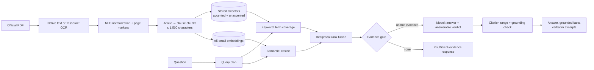

# Retrieval and cited answers

This document describes how TaxLens turns official PDFs into passages, how it finds
the passages for a question, and how it decides whether an answer can be given and
cited. Every step is deterministic except the language model call, and every threshold
named here is a setting.

## 1. Text extraction

The decision is made per page: a page keeps its PDF text layer when that text is usable
(at least 40 non-space characters, at least 20% letters), and only the other pages are
rendered and OCR'd with Tesseract `vie+eng`. In practice the government portal publishes
scans, so nearly every page is OCR text.

OCR settings (`OCR_DPI`, `OCR_PAGE_SEGMENTATION_MODE`, `OCR_TIMEOUT_SECONDS`):

- **300 DPI** rendering (previously about 144 DPI). Vietnamese diacritics are small marks
  and Tesseract is trained for about 300 DPI; at the lower resolution many were lost.
- **Page segmentation mode 3** (automatic layout, previously 6, "one uniform block"). The
  two-column header of Vietnamese legal documents ("CHÍNH PHỦ | CỘNG HÒA XÃ HỘI…") was
  merged into one garbled line under mode 6.
- **Grayscale** rendering and `OMP_THREAD_LIMIT=1`, since Tesseract's threads only contend
  on the API's single vCPU.
- A page that times out is left empty instead of failing the whole document.

These defaults follow Tesseract's guidance; the `ocr_benchmark` action of the
`taxlens_corpus_maintenance` DAG (`scripts/benchmark_ocr.py`) measures word error rate,
with and without diacritics, against a born-digital PDF so they can be confirmed or
tuned. New documents use the current settings; existing ones are re-OCR'd only on request
(`reocr_scanned_documents`).

Remaining OCR errors include lost diacritics (`hóa don`), stray punctuation before
headings (`| Điều 5.`), and misread separators (`Điều 9, Thời điểm`). Later stages are
built to tolerate them rather than assume clean text.

Text is normalized to Unicode NFC (PDF text layers may use decomposed characters that
would never match a typed query), whitespace is collapsed per line, and pages are joined
with a form-feed marker so every chunk keeps page numbers.

## 2. Chunking (`document_processing/process.py`)

Vietnamese legal documents are organized as *Điều* (article) → *khoản* (numbered clause)
→ *điểm* (lettered point). Citations need the article and clause, and both the embedding
model (512 tokens) and the answer prompt (2,500 characters per passage) need short
passages, so chunking follows the legal structure:

1. **Article headings** are lines starting with `Điều N.` / `Điều N:`. Up to six
   characters of OCR noise may precede the keyword, and OCR spellings (`Điêu`, `Điệu`)
   are accepted. A comma separator counts only when an uppercase title follows, so
   `Điều 8, khoản 4 …` (a cross-reference) is rejected. Article numbers must increase,
   which rejects references such as `Điều 3 của Nghị định …` that happen to start a line,
   and a title-less `Điều 19.` directly after a line that ends mid-sentence is treated as
   a wrapped reference. Headings opened by a quotation mark are **not** articles of the
   document: in an amending decree they are the amended text, and treating them as
   articles would cite the wrong article number.
2. **Preamble**: text before the first article (title, issuing body, legal bases) is kept
   as its own chunk, because direct "which document regulates…" questions match it.
3. **Clauses**: an article longer than 1,500 characters is split at its clause numbers
   (`1.`, `2.`, … in sequence, so wrapped lines that begin with a number are ignored). A
   short article introduction stays with clause 1. Each chunk records `article_number`,
   `clause_number`, the article title as `heading`, and its page range.
4. **Size cap**: any remaining segment longer than 1,500 characters is split at line,
   then word, boundaries.

`CHUNKER_VERSION` is recorded in the processing job's stage (`CHUNKED:v2`). When the
chunker changes, the version is bumped and the daily DAG re-chunks every older version
from its stored normalized text (no repeated OCR).

While processing, the number printed in the document header (`Số: 301/2026/NĐ-CP`) is
compared with the stored document number; a mismatch is recorded on the processing job as
`DOCUMENT_NUMBER_MISMATCH` and shown in the document library.

## 3. Keyword retrieval (`retrieval/search.py`)

PostgreSQL stores two generated `tsvector` columns per chunk (migration
`20261017_0005`): one over the text as written and one with Vietnamese diacritics removed
by `translate()`. Only the unaccented column is GIN-indexed.

For a query:

1. The query is split into terms. Question and function words (`là`, `bao nhiêu`, `gì`,
   `của`, …) are dropped; words that change legal meaning, such as `không`, are kept. An
   unaccented term is compared with unaccented stopwords, so `la bao nhieu` is handled
   like `là bao nhiêu` while `cơ` (in `cơ quan`) survives although it folds like `có`.
2. Chunks matching **any** unaccented term are candidates. (The previous implementation
   required every word of the question to appear in one chunk and returned nothing for
   most natural questions.)
3. The score is the number of distinct query terms the chunk contains, plus 0.5 for each
   term that also matches with its accents, plus a cover-density tie-breaker. Chunks
   containing all terms therefore rank first, and the accent bonus keeps `thuế` (tax)
   ahead of `thuê` (rent) although both fold to `thue`.

## 4. Semantic retrieval and fusion

Passages are embedded with `intfloat/multilingual-e5-small` (pinned revision, CPU, baked
into the API image) using the `passage:` / `query:` prefixes. Hybrid search takes 50
candidates from each method and combines them with reciprocal rank fusion (k = 60), which
uses ranks only, so the two score scales never need calibrating. If the embedding model
cannot be loaded, search and Q&A fall back to keyword retrieval instead of failing.

When a question names exactly one document number (`32/2025/TT-BTC`, `48/2024/QH15`,
`18/VBHN-BTC`), retrieval is restricted to that document.

## 5. Evidence gate (`intelligence/evidence.py`)

Before any model call, the top passages (5 by default) are assessed:

| Check | Outcome |
| --- | --- |
| No passages | `NO_EVIDENCE` |
| Best semantic similarity below `QA_MIN_SEMANTIC_SCORE` (0.80) | `LOW_RELEVANCE`, no model call |
| Passages without any article/clause/page locator | dropped (noted) |
| Superseded or expired passages while current ones exist | dropped (noted) |
| Only superseded or expired passages | `INACTIVE_ONLY` |
| One document's versions carry different known statuses | `CONFLICTING_VERSIONS` |
| Otherwise | `SUFFICIENT`; unverified statuses (`DISCOVERED`) are noted |

Exclusions are reported to the user as uncertainties rather than silently applied.

## 6. Answer generation and validation (`intelligence/qa.py`)

The model receives the numbered passages with document, legal status, article, clause,
pages, and article title. It must answer in the language of the question, return
`answerable: false` when the passages do not answer it, and give at most three
confirmed facts that restate their cited passage.

The response is then checked:

- **Answerability**: `answerable: false` becomes `INSUFFICIENT_EVIDENCE` with the
  model's explanation. The semantic floor alone cannot separate out-of-corpus questions
  (measured scores overlap), so the model's verdict is the main refusal path.
- **Citation range**: citation numbers must refer to a provided passage.
- **Grounding**: at least `QA_MIN_FACT_SUPPORT` (50%) of a fact's words, compared without
  diacritics, must occur in the passages it cites. Facts failing either check are removed
  and the removal is reported. A fact with no citation is never attached to every source.
- **Verbatim excerpts**: each citation carries the passage sentence(s) that best match the
  question, copied from the source text, so the interface quotes the law rather than the
  model.
- Unparseable output becomes `INVALID_MODEL_OUTPUT` with the evidence passages listed;
  provider failures become `PROVIDER_UNAVAILABLE` and are logged with the HTTP status and
  the provider's error message.

## 7. Measured effect

`data/evaluation/tax_article_retrieval.json` holds 18 answerable Vietnamese questions
(four typed without diacritics) labelled with the document **and article** that answers
them, plus two out-of-corpus questions. On the five curated tax documents plus four
unrelated decrees (October 2026 OCR text):

| Mode | Metric | Before | After |
| --- | --- | --- | --- |
| Keyword | correct article in top 5 | 0.11 | 1.00 |
| Hybrid | correct article ranked first | 0.56 | 0.83 |
| Hybrid | correct article in top 5 | 0.72 | 1.00 |
| Hybrid | mean reciprocal rank | 0.63 | 0.90 |

The old keyword search returned no results for 11 of the 18 questions, and the old
chunker produced passages of up to 80,953 characters (average 4,241) of which the
model saw only the first 2,500. Those figures flatter the old pipeline: an 80,000-character
"article" counted as a hit even though the answer was usually outside the part the model
saw.

The scheduled evaluation job (`scripts/evaluate_tax_retrieval.py`) reports
`mean_article_hit_at_k` and `mean_article_reciprocal_rank` for this dataset.

## Known limitations

- OCR quality bounds everything: a heading the OCR destroyed (`'Điều'8.`) merges two
  articles, and lost diacritics reduce exact-match ranking.
- Discovered documents have status `DISCOVERED` until someone records whether they are in
  force; answers say so.
- The government portal's pagination is an ASP.NET post-back, so discovery reads the
  newest 50 listings per run. That covers daily publication, but older documents must be
  added through the curated manifest.
- Grounding is lexical: a fact that reuses the passage's words in a misleading order would
  pass. The excerpts let a reader check the source directly.
